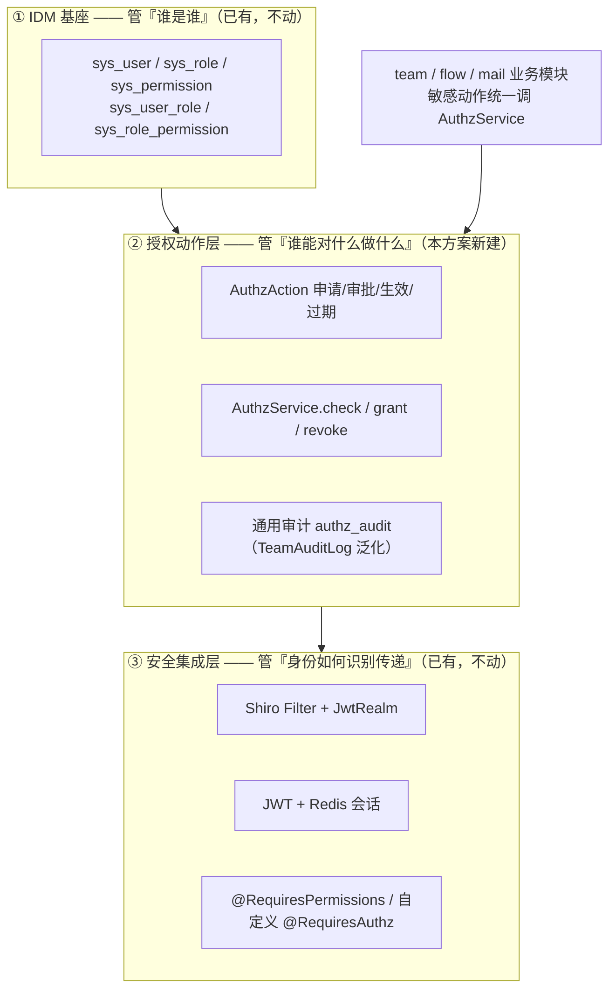
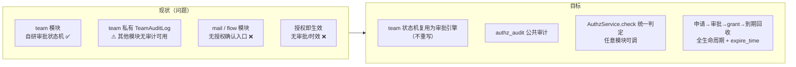
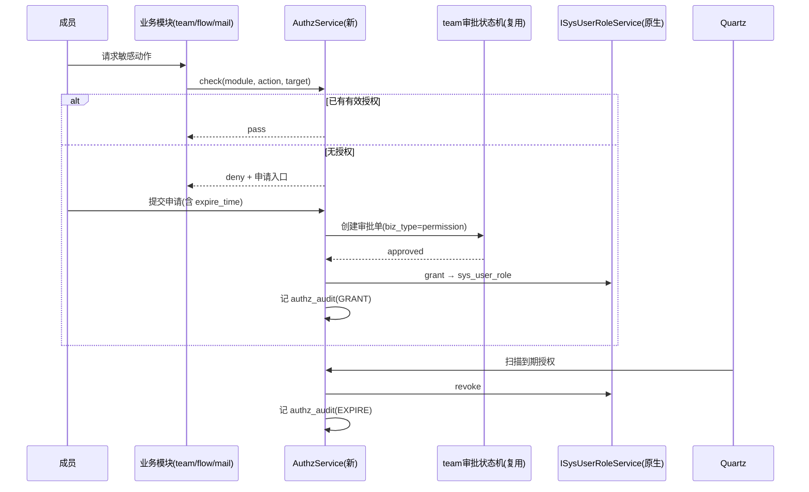

# 授权基座（authz）方案图解与行动计划

> 状态：提案（未立项）
> 日期：2026-11-19
> 背景：权限确认/授权动作目前发生在 team 模块内部，审计日志（TeamAuditLog）亦为模块私有，
> 存在跨模块不可复用风险。借鉴 Flowable 三层分工哲学（IDM / 引擎级动作授权 / 安全集成），
> 不换技术栈，在 Shiro + JWT 现状上补中间层。

## 一、目标分层（对标 Flowable 三层）

单向依赖：业务模块只调 ②，② 读写 ①，③ 在请求边界识别身份。Flowable 同构：
IDM 对应 sys_* 表、引擎权限模型对应 AuthzAction、Spring Security 集成层对应 Shiro/JWT。

## 二、现状 vs 目标

## 三、关键流转（权限申请闭环）

## 四、技术决策记录

| 决策 | 结论 | 依据 |
|:---|:---|:---|
| 换 Spring Security？ | **不换**，维持 Shiro 3.0 + JWT | Jeecg 全链耦合（Filter/Realm/前端签名），迁移重写鉴权全部回归；闸门=出现 OAuth2 开放平台需求再评 |
| 审批引擎自研还是 Flowable？ | **复用 team 自研状态机**，Flowable 仅尖刺保留 | team 状态机已六态闭环+走查报告；闸门=出现可视化编排/会签需求再立项 |
| 审计放哪？ | 泛化为公共 `authz_audit`，TeamAuditLog 并行过渡只读 | 审计上提是本方案回滚最贵单项，需双轨期 |

## 五、行动计划（按序执行）

| # | 任务 | 改动面 | 依赖 | 产出判据 |
|:---|:---|:---|:---|:---|
| 1 | 审计泛化：新建 `authz_audit` 表 + 事件发布（ApplicationEventPublisher + 监听落库） | 新模块 authz | 无 | 发事件即可落库，team 旧审计不动 |
| 2 | AuthzAction 实体 + Flyway 取号 + CRUD | 新模块 authz | 任务1 | 表结构 + 接口可查 |
| 3 | AuthzService.check/grant/revoke，接线 `ISysUserRoleService` / `ISysRolePermissionService` | 新模块 authz → system-biz | 任务2 | 写原生授权表生效 |
| 4 | 自定义 `@RequiresAuthz` 注解 + AOP 切面（base-core 已有切面先例：PermissionDataAspect） | base-core | 任务3 | 注解即可拦截 |
| 5 | 审批回调：复用 team 状态机，`biz_type` 扩展 permission 值 | team 模块 + authz | 任务3 | 申请→审批→grant 全链跑通 |
| 6 | Quartz 到期回收 + EXPIRE 审计 | authz | 任务5 | 临时授权到期自动 revoke |
| 7 | PR checklist + 静态扫描：新增敏感接口必须过 @RequiresAuthz | 仓库规约/脚本 | 任务4 | checklist 入档 |

## 六、风险与回滚

- authz 为旁挂新增模块，证伪弃用不影响在役 team/mail——回滚成本低。
- 任务1/5 触碰 team 模块：TeamAuditLog 双轨过渡（新表并行、旧表只读），上提前需一次性数据迁移评估。
- 严禁动 Jeecg 内核（system-biz 只调不改；Shiro 配置只加注解扫描不改链路）。
