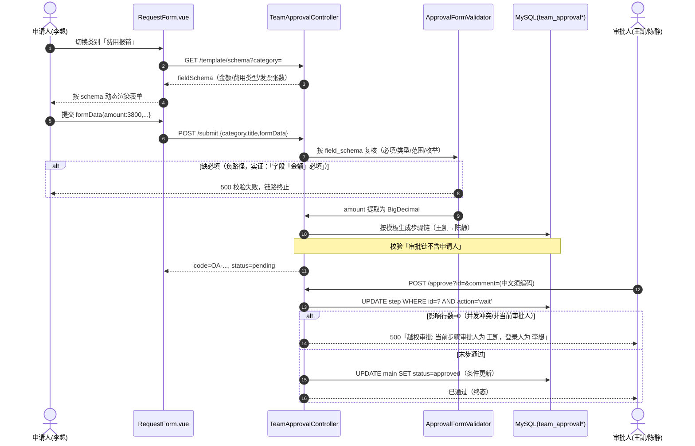
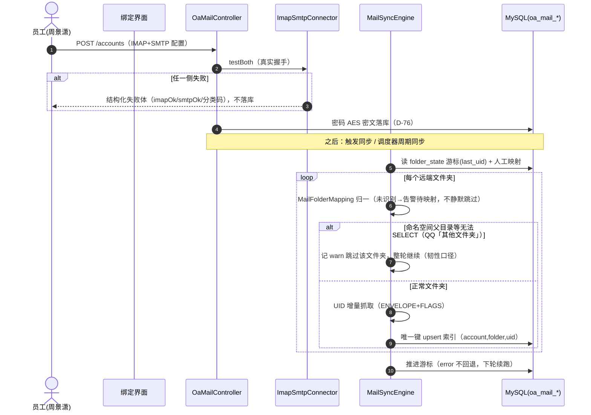
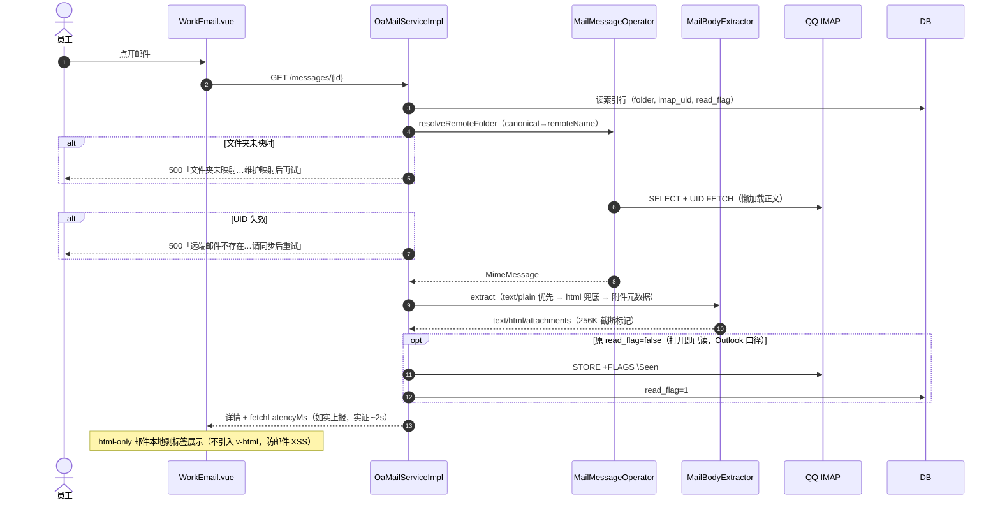
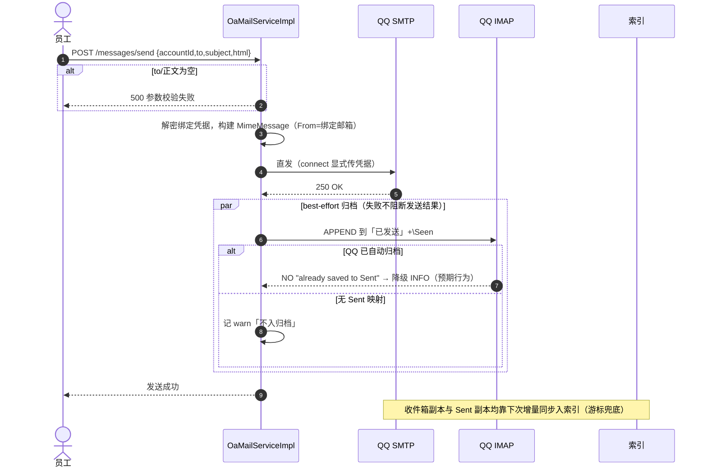
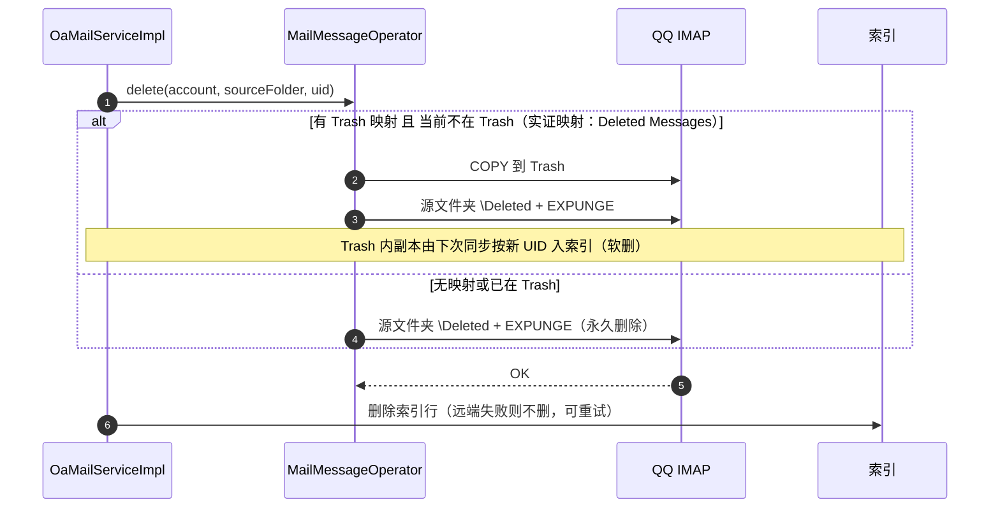
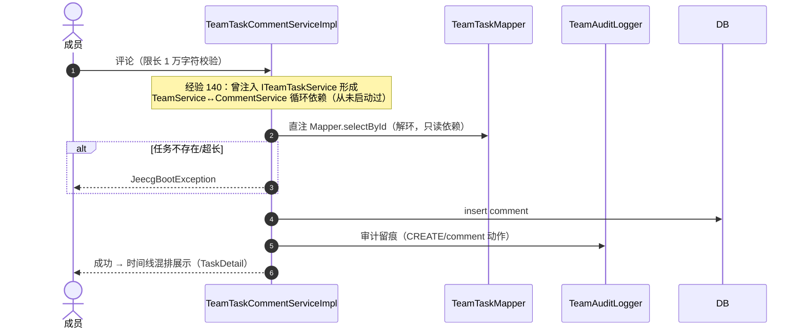

# 业务设计时序图（工程文档）

> 位置约定：本文档是团队协作体系（审批/Issues/邮件）的**业务设计工程文档**，用 Mermaid 时序图
> 描述已闭环的核心链路。改动对应链路时必须同步更新本文（代码评审检查项）。
> 相关：施工/验证报告在各模块 docs/ 下（CLOSURE-WALKTHROUGH / B3-B5-B6-REPORT 等）。

## 1. 审批单全生命周期（v2 + 字段模板）

申请单号 OA-20261118-005/006 为实证样本。关键设计：后端不信任前端（校验器）、条件更新防并发、越权硬拒。

## 2. 员工邮箱绑定与增量同步（B-1/B-2）

## 3. 邮件详情与已读回写（B-3，正文不落库）

## 4. 写信发送（B-6）

## 5. 邮件删除（B-5，双路径）

## 6. 任务评论闭环（Issues 线，循环依赖解法）

