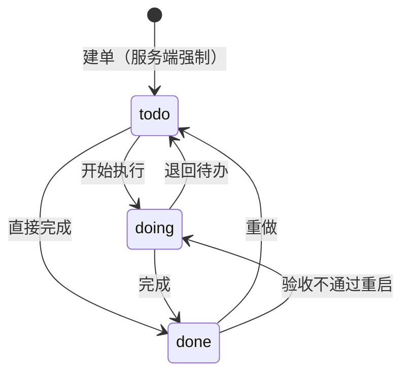
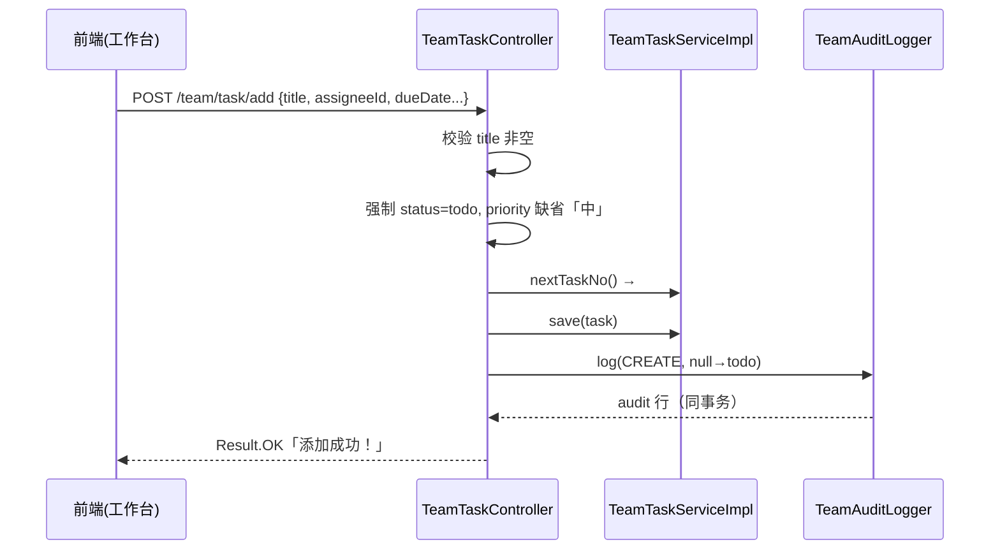
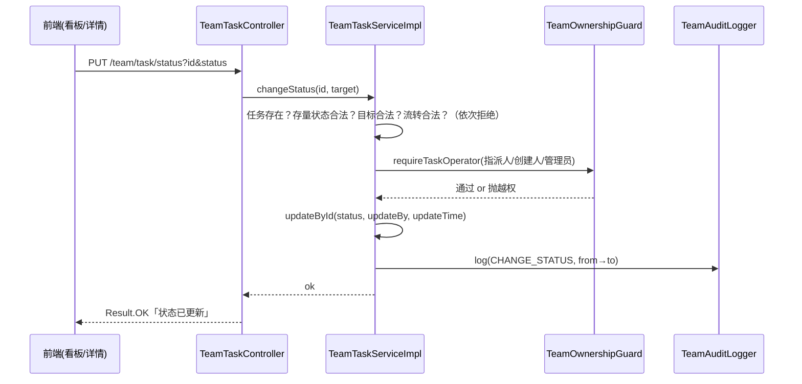
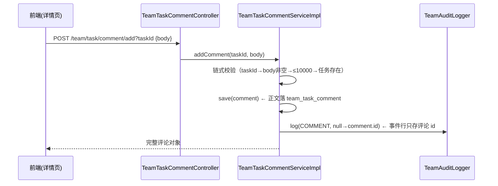
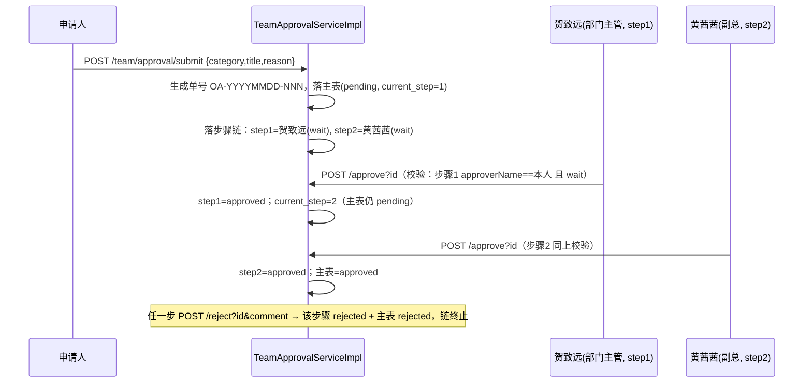

# 业务流程流转设计

> 范围：任务协作主线（建单→流转→评论→归档）+ 事件流/时间线机制 + 审批链对照。
> 伪代码级细节见 [backend-pseudocode.md](backend-pseudocode.md)；表结构见 [sql-schema.md](sql-schema.md)。

## 一、角色与操作权限矩阵

| 操作 | 游客(未登录) | 普通成员 | 任务指派人 | 任务创建人 | 管理员 |
|---|---|---|---|---|---|
| 看列表/看板/详情 | ✗（401） | ✓（需按钮权限） | ✓ | ✓ | ✓ |
| 建单 | ✗ | ✓ | — | — | ✓ |
| 编辑内容 | ✗ | ✗ | ✗ | ✓ | ✓ |
| 状态流转 | ✗ | ✗ | ✓ | ✓ | ✓ |
| 评论 | ✗ | ✓ | ✓ | ✓ | ✓ |
| 删除/批量删除 | ✗ | ✗ | ✗ | ✓ | ✓ |

两道闸门：Shiro 按钮权限（`team:task:*`，403）→ service 层归属校验（越权业务错误）。admin 全放行；未登录上下文在 service 层跳过归属校验（异步补偿场景设计如此，接口层已被 401 拦住）。

## 二、任务状态机



- 六条流转全合法，**done 不是终态**（看板语义下允许重做/重启）；同状态自流转非法。
- 流转只能走 `PUT /team/task/status`；`/edit` 服务端强制回填库中状态，堵住「编辑顺带改状态」的旁路。
- 状态码唯一口径源：`TeamTaskStatus` 枚举 ↔ 库 `status` 列 ↔ 前端 `src/constants/task.ts`。

## 三、核心时序

### 3.1 建单



### 3.2 状态流转



### 3.3 评论进时间线



详情页渲染时 `GET /detail` 一次拉取，前端按 create_time 将 **comments 正文** 与 **timeline 事件** 合并渲染（评论事件 to_value=comment.id 即关联键）。

### 3.4 删除（逻辑删）

```
用户 → DELETE /delete?id
  → service：requireTask → 归属校验（创建人/管理员）
  → removeById → UPDATE deleted=1（@TableLogic 自动追加 deleted=0 条件到一切查询）
批量：先 listByIds 全量校验（数量不符 or 任一越权 → 整体拒绝），再 removeByIds。
```

## 四、事件流（时间线）机制设计

**核心决策（V7 拍板）：不建独立事件表，复用 `team_audit_log` 作为时间线数据源。**

理由：GitHub 的 events 表与 audit_log 完全同构（实体+动作+前后值+操作人+时间），另建 `team_task_event` 只会带来双写漂移；audit_log「只追加不改写」的纪律天然满足事件流语义。

| 产品事件 | audit action | from_value | to_value | 埋点位置 |
|---|---|---|---|---|
| 建单 | create | null | todo | controller.add |
| 状态流转 | change_status | from 状态码 | to 状态码 | service.changeStatus |
| 评论 | comment | null | 评论 id | commentService.addComment |
| 提交审批 | submit | null | 步骤快照 | approvalService |
| 审批通过/拒绝 | approve / reject | 步骤快照 | 步骤快照 | approvalService |

纪律：
- 审计行**只增不改不删**，代码不提供更新/删除路径；业务回滚时审计随事务一起回滚（同事务写入）。
- 动作枚举扩展（如未来的 `added_label`）必须进 `TeamAuditAction` 枚举，不得散装字符串。
- 代价（已知取舍）：审计语义与产品时间线语义耦合——audit 是「谁干了什么」的合规视角，timeline 是「单据经历了什么」的产品视角，当前用一张表服务两个视角，字段语义以 audit 为准。

## 五、审批链对照（二级流程）



试点口径：审批链硬编码（贺致远 → 黄茜茜），按**姓名**匹配；表单模板体系按 D-20261117-68 延后，模板重启后链改由模板下发。

## 六、演进路径（与 .refs 差距表联动）

1. **阶段 1（前端独立，进行中）**：TaskDetail 独立路由 + 侧栏 + StatusBadge/TimelineItem 接 `/team/task/detail` 真实数据。
2. **阶段 2（后端，已大半落地）**：task_no ✅、comment 表 ✅、事件流（audit_log 复用）✅；剩多标签 `tag_list` 待拍（方案见 sql-schema.md §六）。
3. **阶段 3（主题）**：design tokens 切 dark，品牌青绿保留。
