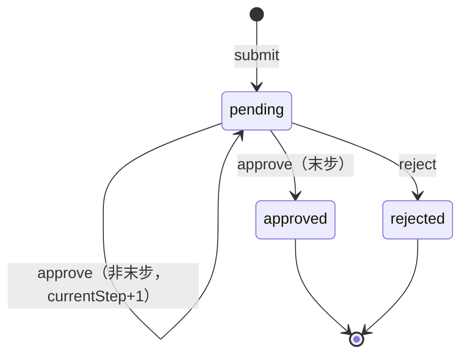
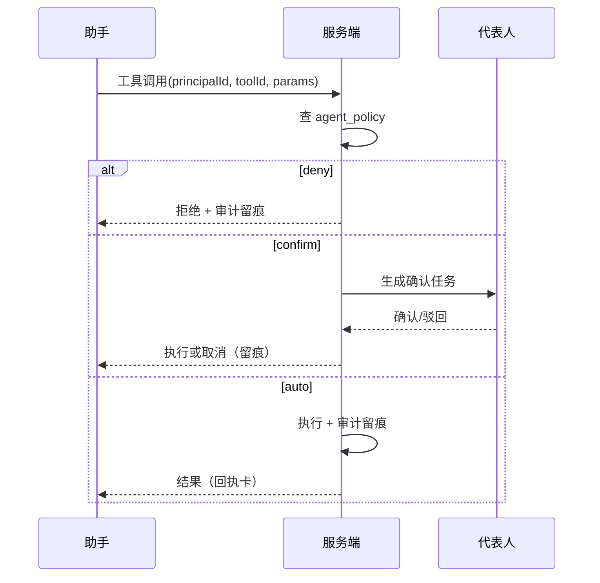

| 项目 | 内容 |
|---|---|
| 文档版本 | **V3.2**（md 主稿，docx 由本文件导出） |
| 编制日期 | 2026-11-17 |
| 密级 | 项目组内部 |
| 真身基线 | 本机 `127.0.0.1:8081/jeecg-boot`，配置 `pilot/w1-trim`，运行级实测 |
| 配套文档 | 《团队协作效率工作台需求规格说明书 V3.2》 |

> **V3.2 变更要点**：① 每个接口补齐请求/响应/错误三段，不再出现"字段结构见返回说明"；② 修正成功码口径 —— 自研 `/team/**` 为 `code=200`、原生 `/sys/**` 多为 `code=0`（旧版一律写 200 是错的）；③ 新增数据模型字典、错误码表、联调检查清单、追溯矩阵；④ 所有示例均为运行实例实测输出（标注 `实测`）或由代码确定的结构（标注 `结构`）。

---

## 目录

1. [使用说明](#1-使用说明)
2. [接入准备](#2-接入准备)
3. [数据模型字典](#3-数据模型字典)
4. [鉴权域](#4-鉴权域)
5. [团队协作域（18 个接口）](#5-团队协作域18-个接口)
6. [原生依赖域（代码级合同）](#6-原生依赖域代码级合同)
7. [设计中域合同](#7-设计中域合同)
8. [联调与排查](#8-联调与排查)
9. [追溯矩阵](#9-追溯矩阵)
10. [已知限制](#10-已知限制)
11. [附录](#11-附录)

---

# 1 使用说明

## 1.1 这份文档解决什么

`doc.html`（Knife4j）由代码注解自动生成，**只覆盖 170 条路径中的一部分**：`/team/**` 18 条全在，`/sys/**` 在用接口全不在（实测结论，见需求审计 F-03）。因此本文件承担两件事：

1. **已实现域**：给出可复制粘贴的请求/响应/错误三段，成员不必翻代码即可联调。
2. **缺失域**：以"代码级合同"补上 doc.html 的空白，并标注 ⚠ —— 这类接口的参数以本文 + 代码为准，doc.html 上查不到。

## 1.2 事实源与优先级

| 优先级 | 事实源 | 适用 |
|---|---|---|
| 1 | **运行实例实测** `127.0.0.1:8081` | 已实现接口的真实行为 |
| 2 | **控制器/服务代码** | 实测覆盖不到的边界（如并发、事务） |
| 3 | **本文件** | 成员日常联调的唯一入口 |
| 4 | doc.html / OpenAPI | 仅作 `/team/**` 的辅助确认 |

四者不一致时以 1、2 为准，并在 issue 里登记，由技术负责人裁决后改本文。

## 1.3 标记约定

| 标记 | 含义 |
|---|---|
| ✅ | 已实现且实测通过 |
| ⚠ | doc.html 未覆盖，以本文为合同 |
| 🧩 | 设计中，合同已定、代码未写（第 7 章） |
| `实测` / `结构` | 示例来源：真实调用返回 / 由代码字段定义构造 |

---

# 2 接入准备

## 2.1 地址矩阵

| 环境 | Base URL | 说明 |
|---|---|---|
| 本机开发后端 | `http://127.0.0.1:8081/jeecg-boot` | 本文件全部实测基于此 |
| 本机前端 dev | `http://127.0.0.1:3200` | vite 代理 `/jeecg-boot` → 8081 |
| 在线接口文档（VM） | `http://100.78.65.37:8080/doc.html` | 团队协作 18 条 / 系统管理 88 条 |
| 桌面壳（Tauri） | 直连 `http://127.0.0.1:8081/jeecg-boot` | 无代理，后端已放行跨域 |

前端两种运行形态由 `src/utils/http.ts` 判定（`__TAURI_INTERNALS__` 存在即 Tauri 直连），业务代码只写相对路径。

## 2.2 鉴权

- 登录换取 token，之后每个请求带请求头 `X-Access-Token: <token>`。
- 前端把 token 存在 `localStorage['team_token']`，由 http 拦截器统一注入。
- 无 token / token 失效：**HTTP 401**，响应体如下（实测）。

```bash
curl -i http://127.0.0.1:8081/jeecg-boot/team/task/list
```

```json
{"success":false,"message":"token为空!","code":401,"result":null,"timestamp":1794884242061}
```

## 2.3 响应包装与两套成功码（**最容易踩的坑**）

所有接口统一返回 `Result<T>`：

```json
{
  "code": 200,
  "message": "",
  "result": { },
  "success": true,
  "timestamp": 1794884237942
}
```

**成功码因域而异**（实测，务必按域判断）：

| 域 | 成功 `code` | 业务失败 `code` | 实测样本 |
|---|---|---|---|
| 自研 `/team/**` | `200` | `500` | `/team/approval/list` → 200；`/team/approval/approve`（终态）→ 500 |
| 原生 `/sys/**` | `0` | `510`（权限） | `/sys/user/list` → 0；`/sys/message/sysMessage/list` → 510 |
| 原生例外 | `200` | — | `/sys/annountCement/getUnreadMessageCount` → 200；`/sys/login`、`/sys/logout` → 200 |

判断建议：**优先看 `success` 布尔值，其次按域的码判断**；不要写死 `code === 200`。

另有一条反直觉约定：`Result.OK("添加成功！")` 这类字符串返回，`message` 与 `result` 同值 —— 见 `/team/task/add` 示例。

## 2.4 分页、过滤与排序

**分页**：`pageNo`（默认 1）、`pageSize`（默认 10）。响应 `result` 结构如下（实测）：

```json
{"current":1,"pages":1,"records":[],"size":2,"total":0}
```

前端约定取 `records` / `total`；`current`/`pages`/`size` 可用于分页器。

**过滤（重要）**：`/team/**` 的列表查询由实体 + `QueryGenerator` 组装，**全部字段精确匹配（eq），没有模糊（like）**（实测）：

| 请求 | total | 结论 |
|---|---|---|
| `/team/approval/list?category=加班` | 0 | 不模糊 |
| `/team/approval/list?category=加班申请` | 2 | 精确命中 |
| `/team/approval/list?title=CDP` | 0 | 标题也不模糊 |
| `/team/approval/list?status=pending` | 1 | 枚举精确过滤可用 |

**排序**：

| 接口 | 排序 |
|---|---|
| `/team/task/list` | `sort_no` 升序 → `create_time` 降序 |
| `/team/bug/list` | `create_time` 降序 |
| `/team/approval/list` | `create_time` 降序 |

## 2.5 时间与编码

- 日期字段：`yyyy-MM-dd`（如 `startDate`、`dueDate`）。
- 时间字段：`yyyy-MM-dd HH:mm:ss`（如 `createTime`、`actedAt`）。
- **查询串里的中文必须 URL 编码**：未编码时 Tomcat 直接回 HTTP 400（实测 `?title=加班` → 400，`?title=%E5%8A%A0%E7%8F%AD` → 200）。因此 `approve/reject` 的 `comment` 走查询参数时必须编码；前端 axios 会自动编码，手测/脚本要注意（审计 F-06）。

## 2.6 错误码表

| code | 典型 message | 触发条件 | 实测 |
|---|---|---|---|
| 200 | 空 / 业务成功文案 | 自研域成功 | ✅ |
| 0 | 空 / 上传相对路径 | 原生域成功 | ✅ |
| 401 | `token为空!` | 未带头或 token 失效（HTTP 401） | ✅ |
| 500 | `任务标题不能为空` | 服务端业务校验失败 | ✅ |
| 500 | `未找到对应数据` | 按 id 查不到 | ✅ |
| 500 | `单据已终审，不可再操作` | 对终态单据 approve/reject | ✅ |
| 500 | `操作失败，Required request parameter 'id' ... not present` | 必填参数缺失（HTTP 仍 200） | ✅ |
| 510 | `没有权限，请联系管理员分配权限！` | 缺按钮/菜单权限 | ✅ |
| — | HTTP 400 | 查询串含未编码中文 | ✅ |

---

# 3 数据模型字典

## 3.1 公共字段

`TeamTask` / `TeamApproval` / `TeamBug` 继承 `JeecgEntity`：

| 字段 | 类型 | 必填 | 说明 |
|---|---|---|---|
| `id` | string | 服务端生成 | 雪花 ID（`IdType.ASSIGN_ID`） |
| `createBy` | string | 服务端填充 | 登录用户名 |
| `createTime` | datetime | 服务端填充 | 创建时间 |
| `updateBy` | string | 服务端填充 | 更新人（edit/状态流转时写） |
| `updateTime` | datetime | 服务端填充 | 更新时间 |

`TeamApprovalStep` 直接实现 `Serializable`，只有 `id`/`createTime`，无 `createBy/updateBy`。

## 3.2 TeamTask（`team_task`）

| 字段 | 类型 | 必填 | 默认 | 说明 |
|---|---|---|---|---|
| `title` | string | **是** | — | 任务标题；空则 500「任务标题不能为空」 |
| `description` | string | 否 | null | 任务描述 |
| `status` | enum | 否 | `todo` | `todo` / `doing` / `done`（与前端 `constants/task.ts` 对齐） |
| `tag` | string | 否 | null | `需求` / `开发` / `缺陷` |
| `priority` | string | 否 | `中` | `高` / `中` / `低` |
| `assigneeId` | string | 否 | null | 被指派人 `sys_user.id` |
| `assigneeName` | string | 否 | null | 姓名冗余（列表免联表） |
| `dueDate` | date | 否 | null | 截止日期 |
| `sortNo` | int | 否 | 0（DB 默认） | 看板列内排序 |

## 3.3 TeamApproval（`team_approval`）

| 字段 | 类型 | 必填 | 默认 | 说明 |
|---|---|---|---|---|
| `code` | string | 服务端生成 | — | 单号 `OA-yyyyMMdd-NNN`，唯一（DB 索引兜底） |
| `category` | string | 否 | null | 申请类别：加班/请假/出差/外出/补卡/费用报销/采购 |
| `title` | string | **是** | — | 事项标题；空则 500「事项标题不能为空」 |
| `reason` | string | 否 | null | 申请事由 |
| `status` | enum | 服务端 | `pending` | `pending` / `approved` / `rejected` |
| `applicantId` | string | 服务端 | — | 取登录用户 id（**客户端传入会被覆盖**） |
| `applicantName` | string | 服务端 | — | 取登录用户 realname |
| `startDate` | date | 否 | null | 开始日期 |
| `endDate` | date | 否 | null | 结束日期 |
| `currentStep` | int | 服务端 | 1 | 当前待审步骤序号 |

## 3.4 TeamApprovalStep（`team_approval_step`）

| 字段 | 类型 | 必填 | 默认 | 说明 |
|---|---|---|---|---|
| `approvalId` | string | 服务端 | — | 所属审批单，由 submit 回填 |
| `stepNo` | int | 服务端 | — | 从 1 开始，按数组顺序分配 |
| `approverName` | string | 建议必填 | null | 审批人姓名（当前是**文本**，不是 userId —— F-02 根因） |
| `approverRole` | string | 否 | null | 角色说明，如「部门主管」 |
| `action` | enum | 服务端 | `wait` | `wait` / `approved` / `rejected` |
| `comment` | string | 否 | null | 审批意见 |
| `actedAt` | datetime | 服务端 | null | 操作时间 |

## 3.5 TeamBug（`team_bug`）

| 字段 | 类型 | 必填 | 默认 | 说明 |
|---|---|---|---|---|
| `description` | string | **是** | — | 问题描述；空则 500「问题描述不能为空」 |
| `screenshotPath` | string | 否 | null | 截图附件相对路径（配合 `/sys/common/upload`） |
| `status` | enum | 服务端 | `open` | 提交时强制 `open`，客户端传值被忽略 |
| `reporterId` / `reporterName` | string | 服务端 | — | 取登录用户 |
| `handlerName` | string | 否 | null | 处理人姓名（当前无分配接口，需 edit 补齐） |

---

# 4 鉴权域

## 4.1 POST /sys/login ✅

请求体：

| 字段 | 类型 | 必填 | 说明 |
|---|---|---|---|
| `username` | string | 是 | 登录名 |
| `password` | string | 是 | 密码（明文提交，服务端按底座规则校验） |

```bash
curl -s -X POST http://127.0.0.1:8081/jeecg-boot/sys/login \
  -H 'Content-Type: application/json' \
  -d '{"username":"admin","password":"123456"}'
```

响应（实测，token/avatar 已脱敏）：

```json
{
  "code": 200,
  "message": "登录成功",
  "result": {
    "token": "<155 位 JWT>",
    "tenantList": [{"id": 1000, "name": "…"}],
    "userInfo": {
      "id": "e9ca23d68d884d4ebb19d07889727dae",
      "username": "admin",
      "realname": "管理员",
      "orgCode": "A01A03",
      "post": null,
      "email": "…",
      "phone": "…"
    }
  },
  "success": true
}
```

前端消费：`stores/auth.ts` 存 `token` 到 `localStorage['team_token']`、`userInfo` 到 `team_user`。

> 开发环境登录验证码已关闭；测试环境（`application-dev.yml`）与生产环境行为不同，联调前确认。

## 4.2 GET /sys/randomImage/{key} ✅

验证码图片。`{key}` 为前端生成的随机串，图片 base64 会绑定该 key，登录时回传 `captcha`+`checkKey`（验证码开启时）。

```json
{"code":0,"message":"","result":"data:image/jpg;base64,/9j/4AAQ…","success":true}
```

## 4.3 POST /sys/logout ✅

带 `X-Access-Token` 调用即注销当前会话，token 随即失效（实测：注销后同 token 调 `/team/task/list` 返回 HTTP 401）。

```json
{"code":200,"message":"退出登录成功！","result":"退出登录成功！","success":true}
```

---

# 5 团队协作域（18 个接口）

**通用**：全部需要 `X-Access-Token`；成功码 `200`；业务失败 `500`；请求体 `Content-Type: application/json`。

## 5.1 总览

| # | 方法 | 路径 | 用途 | 前端调用点 |
|---|---|---|---|---|
| 1 | POST | `/team/task/add` | 新增任务 | 任务看板（M3） |
| 2 | PUT | `/team/task/edit` | 编辑任务 | 任务看板 |
| 3 | DELETE | `/team/task/delete` | 删除任务 | 任务看板 |
| 4 | DELETE | `/team/task/deleteBatch` | 批量删除任务 | 任务看板 |
| 5 | GET | `/team/task/list` | 任务分页 | 任务看板 |
| 6 | GET | `/team/task/queryById` | 任务详情 | 任务看板 |
| 7 | POST | `/team/bug/add` | 提交反馈 | `QuickFormCard` `BugReport` |
| 8 | PUT | `/team/bug/status` | 反馈状态流转 | `BugReport` |
| 9 | DELETE | `/team/bug/delete` | 删除反馈 | `BugReport` |
| 10 | DELETE | `/team/bug/deleteBatch` | 批量删除反馈 | `BugReport` |
| 11 | GET | `/team/bug/list` | 反馈分页 | `BugReport` `Dashboard` |
| 12 | GET | `/team/bug/queryById` | 反馈详情 | `BugReport` |
| 13 | POST | `/team/approval/submit` | 提交申请（含步骤模板） | `RequestForm` `QuickFormCard` |
| 14 | POST | `/team/approval/approve` | 通过当前步骤 | `ApprovalCenter` |
| 15 | POST | `/team/approval/reject` | 拒绝当前步骤 | `ApprovalCenter` |
| 16 | GET | `/team/approval/list` | 审批分页（tab 过滤） | `ApprovalCenter` `Dashboard` |
| 17 | GET | `/team/approval/queryById` | 审批详情 | `ApprovalCenter` |
| 18 | GET | `/team/approval/steps` | 步骤链 | `ApprovalCenter` |

## 5.2 任务

### 5.2.1 POST /team/task/add

新增任务。服务端行为：校验 `title` → 默认 `status=todo`、`priority=中` → 写 `createBy`/`createTime`。

请求体（`TeamTask` 字段，只需传业务字段）：

```json
{
  "title": "文档示例-任务",
  "description": "md 文档示例数据",
  "tag": "需求",
  "priority": "高",
  "assigneeName": "管理员",
  "dueDate": "2026-11-20"
}
```

响应（实测）：

```json
{"code":200,"message":"添加成功！","result":"添加成功！","success":true,"timestamp":1794884378060}
```

> 注意 `result` 是字符串不是实体 —— 拿不到新 id，需要刷新列表。

错误：`title` 缺失 → `{"code":500,"message":"任务标题不能为空","success":false}`。

### 5.2.2 PUT /team/task/edit

编辑任务，**必须带 `id`**；服务端先查存在性，再写 `updateBy`/`updateTime`。

```json
{"id":"2122525036873433090","title":"改名后的任务","status":"doing"}
```

响应：`{"code":200,"message":"编辑成功!","result":"编辑成功!"}`；id 不存在 → `500 未找到对应数据`。

**部分更新语义**：底层 `updateById` 忽略 null 字段，未传的字段保持原值。

### 5.2.3 DELETE /team/task/delete

| 参数 | 位置 | 类型 | 必填 | 说明 |
|---|---|---|---|---|
| `id` | query | string | 是 | 主键 |

响应（实测）：`{"code":200,"message":"删除成功!","result":"删除成功!"}`。

> ⚠ 无归属校验：任何登录用户可删任意任务（需求审计 F-09）。

### 5.2.4 DELETE /team/task/deleteBatch

| 参数 | 位置 | 类型 | 必填 | 说明 |
|---|---|---|---|---|
| `ids` | query | string | 是 | 逗号分隔主键，如 `a,b,c` |

响应：`{"code":200,"message":"批量删除成功!"}`。

### 5.2.5 GET /team/task/list

| 参数 | 位置 | 类型 | 必填 | 说明 |
|---|---|---|---|---|
| `pageNo` | query | int | 否 | 默认 1 |
| `pageSize` | query | int | 否 | 默认 10 |
| 其余 | query | — | 否 | 任意 `TeamTask` 字段，**精确匹配** |

响应（实测）：

```json
{
  "code": 200,
  "result": {
    "current": 1, "pages": 1, "size": 1, "total": 1,
    "records": [{
      "id": "2122525036873433090",
      "title": "文档示例-任务",
      "description": "md 文档示例数据",
      "status": "todo",
      "tag": "需求",
      "priority": "高",
      "assigneeId": null,
      "assigneeName": "管理员",
      "dueDate": "2026-11-20",
      "sortNo": 0,
      "createBy": "admin",
      "createTime": "2026-11-17 10:59:38",
      "updateBy": null,
      "updateTime": null
    }]
  },
  "success": true
}
```

### 5.2.6 GET /team/task/queryById

| 参数 | 位置 | 类型 | 必填 |
|---|---|---|---|
| `id` | query | string | 是 |

响应 `result` 为单个 `TeamTask`；查不到 → `500 未找到对应数据`。

## 5.3 问题反馈

### 5.3.1 POST /team/bug/add

```json
{"description": "审批中心分页器偶发不刷新", "screenshotPath": "probe/shot_1794884289818.png"}
```

服务端行为：`description` 必填 → 强制 `status=open` → 写 `reporterId/reporterName/createBy/createTime`。

响应：`{"code":200,"message":"反馈已提交","result":"反馈已提交"}`。

### 5.3.2 PUT /team/bug/status

| 参数 | 位置 | 类型 | 必填 | 说明 |
|---|---|---|---|---|
| `id` | query | string | 是 | 主键 |
| `status` | query | string | 是 | `open` / `processing` / `resolved` / `closed` |

响应：`{"code":200,"message":"状态已更新"}`；id 不存在 → `500 未找到对应数据`。

> ⚠ 服务端**不校验枚举值**，传 `foo` 也会落库。前端必须在提交前约束（`BugReport` 用固定按钮即可）。

### 5.3.3 DELETE /team/bug/delete、/team/bug/deleteBatch

参数与任务删除一致（`id` / `ids`），响应 `删除成功!` / `批量删除成功!`。同样无归属校验。

### 5.3.4 GET /team/bug/list

参数同任务分页（`pageNo`/`pageSize` + `TeamBug` 字段精确匹配），排序 `create_time` 降序。

响应（实测）：

```json
{
  "code": 200,
  "result": {
    "current": 1, "pages": 1, "size": 2, "total": 1,
    "records": [{
      "id": "2122298713841831937",
      "description": "验收测试-bug反馈",
      "screenshotPath": null,
      "status": "processing",
      "reporterId": "e9ca23d68d884d4ebb19d07889727dae",
      "reporterName": "管理员",
      "handlerName": null,
      "createBy": "admin",
      "createTime": "2026-11-16 20:00:18",
      "updateBy": "admin",
      "updateTime": "2026-11-16 20:00:19"
    }]
  },
  "success": true
}
```

### 5.3.5 GET /team/bug/queryById

`id` 必填，返回单个 `TeamBug`；查不到 → `500 未找到对应数据`。

## 5.4 审批

### 5.4.1 POST /team/approval/submit

提交申请 + 步骤模板，单事务写入 `team_approval` 与 `team_approval_step`。

请求体：

```json
{
  "approval": {
    "category": "加班申请",
    "title": "周四加班配合上线",
    "reason": "版本发布值守",
    "startDate": "2026-11-19",
    "endDate": "2026-11-19"
  },
  "steps": [
    {"approverName": "部门主管", "approverRole": "一级审批"},
    {"approverName": "分管副总", "approverRole": "二级审批"}
  ]
}
```

| 字段 | 必填 | 说明 |
|---|---|---|
| `approval.title` | 是 | 空则 500「事项标题不能为空」 |
| `steps` | 是 | 至少 1 条，空则 500「审批流程至少需要一个步骤」 |
| `steps[].approverName` | 建议 | 审批人姓名文本；**当前无 userId 校验**（F-02） |
| `steps[].approverRole` | 否 | 角色说明，仅展示 |
| `approval.applicantId/Name` | 否 | 客户端传了也会被登录用户覆盖 |
| `approval.code/status/currentStep` | 否 | 由服务端生成/覆盖 |

响应（结构，字段取自真实单据）：`result` 为落库后的 `TeamApproval`，含 `code`、`status=pending`、`currentStep=1`。

```json
{
  "code": 200,
  "result": {
    "id": "2122298711287500801",
    "code": "OA-20261116-001",
    "category": "加班申请",
    "title": "验收测试-加班申请",
    "reason": "接口联调",
    "status": "pending",
    "applicantId": "e9ca23d68d884d4ebb19d07889727dae",
    "applicantName": "管理员",
    "startDate": "2026-11-20",
    "endDate": "2026-11-21",
    "currentStep": 1,
    "createBy": "admin",
    "createTime": "2026-11-16 20:00:18"
  },
  "success": true
}
```

**单号生成**：`OA-<yyyyMMdd>-<当日第 N 单，三位>`，实现为"当日计数 +1"（代码内已标 `ponytail:` 注释）。高并发下可能撞号，靠唯一索引兜底报错 —— 试点规模可接受，规模化需换 Redis 发号。

### 5.4.2 POST /team/approval/approve

| 参数 | 位置 | 类型 | 必填 | 说明 |
|---|---|---|---|---|
| `id` | query | string | 是 | 审批单 id |
| `comment` | query | string | 否 | 意见（中文必须 URL 编码） |

服务端行为：校验 `status=pending` → 当前步骤置 `approved` 并写 `comment`/`actedAt` → 非末步 `currentStep+1`，末步整单 `approved`。

```bash
curl -X POST "http://127.0.0.1:8081/jeecg-boot/team/approval/approve?id=2122307795827003393&comment=%E5%90%8C%E6%84%8F" \
  -H "X-Access-Token: $TOKEN"
```

响应：`{"code":200,"message":"已通过","result":"已通过"}`。

错误（实测）：

```json
{"code":500,"message":"单据已终审，不可再操作","result":null,"success":false}
```

> ⚠ 不校验操作人身份：任何登录用户都能审批任意单据（F-02，R-01 范围内修复）。

### 5.4.3 POST /team/approval/reject

参数同 approve（`id` 必填、`comment` 可选）。服务端行为：当前步骤置 `rejected`，整单 `rejected`（终态）。

响应：`{"code":200,"message":"已拒绝","result":"已拒绝"}`。

### 5.4.4 GET /team/approval/list

| 参数 | 位置 | 类型 | 必填 | 说明 |
|---|---|---|---|---|
| `status` | query | string | 否 | tab 过滤：`pending` / `approved` / `rejected`，不传为全部 |
| `applicantId` | query | string | 否 | "我的申请" |
| `pageNo` / `pageSize` | query | int | 否 | 默认 1 / 10 |

响应（实测）：

```json
{
  "code": 200,
  "result": {
    "current": 1, "pages": 1, "size": 3, "total": 3,
    "records": [{
      "id": "2122307795827003393",
      "code": "OA-20261116-003",
      "category": "加班申请",
      "title": "CDP联调-会话内加班申请",
      "reason": "",
      "status": "pending",
      "applicantId": "e9ca23d68d884d4ebb19d07889727dae",
      "applicantName": "管理员",
      "startDate": null,
      "endDate": null,
      "currentStep": 1,
      "createBy": "admin",
      "createTime": "2026-11-16 20:36:24"
    }]
  },
  "success": true
}
```

前端消费：`Dashboard` 并发两次（`status=pending` 与 `applicantId=本人`）；`ApprovalCenter` 按 tab 传 `status`。

### 5.4.5 GET /team/approval/queryById

`id` 必填，返回单个 `TeamApproval`；查不到 → `500 未找到对应数据`。

### 5.4.6 GET /team/approval/steps

`id` 必填（审批单 id），返回步骤链数组，按 `stepNo` 升序（实测）：

```json
{
  "code": 200,
  "result": [
    {"id":"2122298711312666626","approvalId":"2122298711287500801","stepNo":1,
     "approverName":"贺致远","approverRole":"部门主管","action":"approved",
     "comment":null,"actedAt":"2026-11-16 20:00:18","createTime":"2026-11-16 20:00:18"},
    {"id":"2122298711329443841","approvalId":"2122298711287500801","stepNo":2,
     "approverName":"黄茜茜","approverRole":"副总经理","action":"approved",
     "comment":null,"actedAt":"2026-11-16 20:00:43","createTime":"2026-11-16 20:00:18"}
  ],
  "success": true
}
```

### 5.4.7 审批状态机



步骤动作：`wait` → `approved` / `rejected`；终态单据再操作返回 500「单据已终审，不可再操作」。

---

# 6 原生依赖域（⚠ 代码级合同）

以下接口在 `doc.html` 中**查不到**（`v3/api-docs` 无对应路径，实测），参数以本章为准。

## 6.1 公告（⚠）

| 接口 | 方法 | 参数 | 响应要点 |
|---|---|---|---|
| `/sys/annountCement/listByUser` | GET | `pageSize`（int，默认 5） | `result` 是 **Map**：`anntMsgList`/`anntMsgTotal`（公告）、`sysMsgList`/`sysMsgTotal`（通知）；时间窗从**上月 1 日**起 |
| `/sys/annountCement/getUnreadMessageCount` | GET | `pageSize`（int，默认 5） | `result`：`{systemCount, planCount, count, flowCount, fileCount}` |
| `/sys/annountCement/list` | GET | `pageNo`/`pageSize` + 实体字段 | 公告管理分页（管理员），`result.records/total` |

实测响应（本环境暂无公告）：

```json
{"code":0,"message":"","result":{"sysMsgList":[],"anntMsgTotal":0,"sysMsgTotal":0,"anntMsgList":[]},"success":true}
```

字段坑：标题字段名为 **`titile`**（上游拼写如此），不是 `title`；正文 `msgContent`；`sender` / `priority` / `sendTime`。

前端消费（已按此修正，审计 F-01）：`api/announcement.ts` 显式传 `pageSize: 50` 并取 `anntMsgList`。

## 6.2 组织与人员（⚠）

| 接口 | 方法 | 参数 | 响应要点 |
|---|---|---|---|
| `/sys/sysDepart/queryTreeList` | GET | `ids`（可选，逗号分隔） | `result` **直接是树数组**，子节点在 `children` |
| `/sys/user/list` | GET | `pageNo`/`pageSize` + `SysUser` 字段 | `result.records/total`，含多租户隔离 |
| `/sys/user/listAll` | GET | — | `result.records` 全量用户（人员选择器） |

部门树节点关键字段：`id`、`parentId`、`departName`、`orgCode`、`orgCategory`、`orgType`、`isLeaf`、`children`。

> ⚠ `SysDepartTreeModel` **没有 `leaderName` 字段**：统计"部门负责人"时显示 `-`，不要造假数据。

实测 `listAll`：

```json
{"code":0,"result":{"current":1,"pages":1,"records":[{"id":"1714471285016895490","username":"ceshi","realname":"测试用户","orgCode":null,"status":1}]}}
```

## 6.3 文件上传（⚠）

| 接口 | 方法 | 参数 | 说明 |
|---|---|---|---|
| `/sys/common/upload` | POST multipart | `file`（文件）、`biz`（可选，业务子目录） | 服务端做类型/漏洞校验；存储由 `jeecg.uploadType` 决定 |

实测（上传一个 10 字节 txt，`biz=probe`）：

```json
{"code":0,"message":"probe/probe_1794884289818.txt","result":null,"success":true}
```

> **相对路径在 `message` 里，不在 `result`**（`result` 为 null）。前端 `ResourceCenter` 取 `message` 作为后续 `screenshotPath`。

## 6.4 站内消息（⚠ 当前不可用）

| 接口 | 方法 | 实测结果 |
|---|---|---|
| `/sys/message/sysMessage/list` | GET | `{"code":510,"message":"没有权限，请联系管理员分配权限！"}` |

接入收件箱（R-04/M2）前必须先给账号分配对应菜单/按钮权限（审计 F-10）。

## 6.5 个人报表（⚠）

| 接口 | 方法 | 说明 |
|---|---|---|
| `/jmreport/list` | GET | 报表列表页，页面需带 `token` 参数（`?token=<JWT>`），返回 HTML |
| `/jmreport/designReport/*` | — | 报表设计器，管理员用 |

前端 `PersonalReport.vue` 以 iframe 嵌入 `/jeecg-boot/jmreport/list?token=`，实测 HTTP 200；假 token 会报"Token 校验失败"，联调时用真实登录 token。

---

# 7 设计中域合同

本章为**未实现**的接口契约（🧩）。实现方按此写，前端可按此先做骨架；变更须经技术负责人确认并同步本文。

## 7.1 流程编排域

### 7.1.1 模板节点 JSON

模板 `nodes` 字段为一个节点数组 + 入口 key：

```json
{
  "start": "n1",
  "nodes": [
    {"key":"n1","type":"seq","name":"直属主管审批",
     "assignees":[{"userId":"u1","name":"主管"}],"next":{"default":"n2"}},
    {"key":"n2","type":"cond","name":"金额分支",
     "when":{"field":"amount","op":">=","value":50000},
     "next":{"true":"n3","false":"n4"}},
    {"key":"n3","type":"sign","name":"跨域会签","signStrategy":"all",
     "assignees":[{"userId":"u2","name":"CFO"},{"userId":"u3","name":"AI 域 VP"}],
     "next":{"default":"n5"}},
    {"key":"n4","type":"seq","name":"部门复核",
     "assignees":[{"userId":"u4","name":"部门负责人"}],"next":{"default":"n5"}},
    {"key":"n5","type":"seq","name":"归档","assignees":[],"next":{"default":"__end__"}}
  ]
}
```

| 字段 | 取值 | 约束 |
|---|---|---|
| `type` | `seq` / `sign` / `cond` | 仅此三种，扩展须改契约 |
| `signStrategy` | `any` / `all` | `any`=首个通过即流转；`all`=全部通过；任一拒绝整单拒绝 |
| `when.field` | 表单字段名 | 白名单：只允许当前表单字段 |
| `when.op` | `>=` / `<=` / `==` / `!=` / `in` | 首期只实现 `>=`、`==`、`in` |
| `when.value` | 标量 / 数组 | 类型须与字段一致 |
| `next` | `{default}` 或 `{true,false}` | `cond` 必须给双分支 |

### 7.1.2 接口

| # | 方法 | 路径 | 用途 | 请求要点 |
|---|---|---|---|---|
| 1 | GET | `/team/flow/def/list` | 模板分页 | `pageNo`/`pageSize`，可按 `code`/`status` 过滤 |
| 2 | GET | `/team/flow/def/queryById` | 模板详情 | `id` |
| 3 | POST | `/team/flow/def/save` | 保存模板（新增/编辑） | `{code,name,nodes,status}`；`code` 唯一 |
| 4 | POST | `/team/flow/def/publish` | 发布新版本 | `{id}`；version+1，旧版本保留 |
| 5 | POST | `/team/flow/inst/start` | 发起实例 | `{defCode,formData:{...}}`；锁模板版本 |
| 6 | GET | `/team/flow/inst/list` | 实例分页 | `status`/`applicantId`/`defCode` |
| 7 | GET | `/team/flow/inst/queryById` | 实例详情（含节点进度） | `id` |
| 8 | POST | `/team/flow/inst/cancel` | 撤销实例 | `{id,reason}` |
| 9 | GET | `/team/flow/task/todo` | 我的待办（按截止时间升序） | `domain`/`type` 可选 |
| 10 | POST | `/team/flow/task/approve` | 通过任务 | `{taskId,comment}` |
| 11 | POST | `/team/flow/task/reject` | 拒绝任务 | `{taskId,comment}`，`comment` 必填 |
| 12 | POST | `/team/flow/task/batchApprove` | 批量通过 | `{taskIds:[],comment}`；返回逐条结果 |
| 13 | GET | `/team/flow/delegate/list` | 我的委托（发起/受托双视角） | `role=from\|to` |
| 14 | POST | `/team/flow/delegate/add` | 新增委托 | `{fromUserId,toUserId,startAt,endAt,scopes}` |
| 15 | POST | `/team/flow/delegate/revoke` | 撤销委托 | `{id}` |

**批量审批响应**（逐条结果，部分失败不影响其余）：

```json
{"code":200,"result":{"succeeded":["t1","t2"],"failed":[{"taskId":"t3","message":"任务已被他人处理"}]},"success":true}
```

### 7.1.3 约束（实现必须满足）

1. 实例锁定 `def_version` 快照，模板后续修改不影响在途实例。
2. 条件求值只读 `formData`，求值器不接外部数据源；表达式解析失败按"模板非法"拒绝发起。
3. 会签 `any` 结算通过后，其余同类任务自动置 `cancelled`（不再出现在待办）。
4. 委托成环（A→B→A）在 `add` 时拒绝，返回 500 + 明确文案。
5. 终态（approved/rejected/cancelled）实例的任务操作一律 500「实例已终态」。
6. 每一步落痕：`acted_by` 记实际处理人（委托场景下与 `assignee_id` 不同）。

## 7.2 决策记录域 🧩

| # | 方法 | 路径 | 请求要点 |
|---|---|---|---|
| 1 | POST | `/team/decision/add` | `{background,options[],conclusion,objections,ownerId,decidedAt}` |
| 2 | GET | `/team/decision/list` | `ownerId`/`domain`/`from`/`to` + 分页 |
| 3 | POST | `/team/decision/link` | `{decisionId,bizType,bizId}`，`bizType` 枚举含 `approval`/`flowTask` |

字段：

| 字段 | 类型 | 必填 | 说明 |
|---|---|---|---|
| `background` | text | 是 | 决策背景 |
| `options` | array | 是 | 备选项（至少 2 条） |
| `conclusion` | text | 是 | 结论 |
| `objections` | text | 否 | 反对意见（允许保留异议） |
| `ownerId` | string | 是 | 结论归属人（助手不可作为归属人） |
| `decidedAt` | datetime | 是 | 决策时间 |

## 7.3 人机治理域 🧩

| # | 方法 | 路径 | 请求要点 |
|---|---|---|---|
| 1 | GET | `/agent/profile/list` | `principalId`/`keyword` + 分页 |
| 2 | POST | `/agent/profile/save` | `{userId,principalId,capabilities[],dataScope,quota}` |
| 3 | GET | `/agent/policy/list` | `agentId` |
| 4 | POST | `/agent/policy/save` | `{agentId,toolId,level}`；`level=auto\|confirm\|deny` |
| 5 | GET | `/agent/audit/list` | `agentId`/`principalId`/`tool`/`from`/`to` |

**强制校验**（服务端，非前端）：助手侧工具调用必须携带 `principalId` 与 `policyResult`，缺失即拒绝执行并落审计记录；`level=deny` 直接拒绝；`level=confirm` 生成确认任务推给代表人。



---

# 8 联调与排查

## 8.1 联调检查清单

| # | 检查项 | 通过标准 |
|---|---|---|
| 1 | 后端在役 | `curl -o /dev/null -w '%{http_code}' <base>/v3/api-docs` → 200 |
| 2 | 前端在役 | `http://127.0.0.1:3200` 返回页面 |
| 3 | 能登录 | `POST /sys/login` 返回 token |
| 4 | 带 token 调用 | `/team/approval/list` 返回 `code=200` |
| 5 | 中文参数编码 | 未编码 → 400，编码后 → 200（验证 BR-09） |
| 6 | 分页约定 | 响应含 `records`/`total` |
| 7 | 成功码按域判断 | `/team/**`=200、`/sys/**`=0，未误用统一 200 |
| 8 | 公告解析 | `result` 取 `anntMsgList`，不是数组 |
| 9 | 上传路径 | 取 `message` 而非 `result` |
| 10 | 数据库落库 | 提交后 `team_approval`/`team_approval_step` 各增记录 |

## 8.2 错误对照

| 现象 | 可能原因 | 处理 |
|---|---|---|
| HTTP 401 + `token为空!` | 未带 `X-Access-Token` 或已过期 | 重新登录 |
| HTTP 400 | 查询串含裸中文 | URL 编码 |
| `code=500 单据已终审` | 单据已 approved/rejected | 刷新列表，勿重试 |
| `code=500 未找到对应数据` | id 错 / 数据被删 | 重新查询 |
| `code=510 没有权限` | 缺按钮/菜单权限 | 找管理员分配（站内消息即此因） |
| `code=500 Required request parameter...` | 必填参数缺失 | 补参数 |
| 列表 total=0 但数据确实存在 | 用了模糊值 | 改精确值（BR-10） |
| 桌面壳请求 404 | 用了相对路径 | Tauri 形态走绝对地址（`http.ts` 已处理） |

## 8.3 可复制回归脚本

冒烟 8 步（bash，Windows Git Bash 可用）：

```bash
BASE=http://127.0.0.1:8081/jeecg-boot
TOKEN=$(curl -s -X POST $BASE/sys/login -H 'Content-Type: application/json' \
  -d '{"username":"admin","password":"123456"}' | python -c "import sys,json;print(json.load(sys.stdin)['result']['token'])")

# 1 列表（自研域成功码 200）
curl -s "$BASE/team/approval/list?pageNo=1&pageSize=2" -H "X-Access-Token: $TOKEN"
# 2 原生域成功码 0
curl -s "$BASE/sys/annountCement/listByUser?pageSize=5" -H "X-Access-Token: $TOKEN"
# 3 精确过滤验证（应为 0）
curl -s "$BASE/team/approval/list?title=CDP" -H "X-Access-Token: $TOKEN"
# 4 未编码中文（应为 HTTP 400）
curl -s -o /dev/null -w '%{http_code}\n' "$BASE/team/approval/list?title=加班" -H "X-Access-Token: $TOKEN"
# 5 终态守卫（应 500 单据已终审）
curl -s -X POST "$BASE/team/approval/approve?id=<已通过的单据id>" -H "X-Access-Token: $TOKEN"
# 6 无 token（应 HTTP 401）
curl -s -o /dev/null -w '%{http_code}\n' "$BASE/team/task/list"
# 7 部门树（code 0，result 为数组）
curl -s "$BASE/sys/sysDepart/queryTreeList" -H "X-Access-Token: $TOKEN"
# 8 权限缺口（应 510）
curl -s "$BASE/sys/message/sysMessage/list?pageNo=1&pageSize=1" -H "X-Access-Token: $TOKEN"
```

---

# 9 追溯矩阵

| 页面 | 主要接口 | 需求编号 | 状态 |
|---|---|---|---|
| 仪表盘 | `/team/approval/list`×2、`/sys/annountCement/listByUser` | UC-O-01/02 | ✅ |
| 日常申请 | `/team/approval/submit` | UC-T-01 | ✅ |
| 审批中心 | `/team/approval/list`、`/approve`、`/reject`、`/steps` | UC-T-02/03/04 | ✅ |
| Bug 反馈 | `/team/bug/add`、`/list`、`/status` | UC-T-05 | ✅ |
| 资料中心 | `/sys/common/upload` | UC-T-06 | ✅ |
| 个人报表 | `/jmreport/list` | UC-T-06 | ✅ |
| 人事管理 | `/sys/sysDepart/queryTreeList`、`/sys/user/list` | UC-M-01/02 | ✅ |
| 行政管理 / 教务 / 后勤 | 待定 | UC-M-03 | 📋 |
| 市场活动 / 职业教育 / 学生服务 | 待定（学生服务复用审批） | UC-S-01~03 | 📋 |
| 工作邮箱 | 待定（SMTP） | UC-T-07 | 📋 |
| 会话工作台 | `/team/approval/submit`、`/team/bug/add`、`/team/approval/approve` | UC-C-01~03 | ✅（通路待 M2） |
| 任务看板 | `/team/task/**` | —（M3） | ✅ 接口就绪 |

---

# 10 已知限制

| # | 限制 | 影响 | 关联 |
|---|---|---|---|
| 1 | 审批不校验操作人 | 越权审批 | F-02 |
| 2 | 团队域无按钮权限、删除/编辑无归属校验 | 越权删改 | F-09 |
| 3 | 团队域列表只支持精确匹配 | 无搜索能力 | F-07 / BR-10 |
| 4 | 单号"当日计数+1"生成 | 高并发撞号（唯一索引报错） | R-01 |
| 5 | `bug/status` 不校验枚举 | 脏状态可能入库 | 前端约束 |
| 6 | `bug` 无处理人分配接口 | `handlerName` 只能靠 edit 补 | UC-T-05 |
| 7 | 审批步骤为姓名文本 | 无法做"待我审批"归属查询 | F-02 |
| 8 | `task/add` 不返回 id | 需刷新列表拿数据 | — |
| 9 | 站内消息 510 | 收件箱不可用 | F-10 |
| 10 | 公告字段 `titile` 拼写 | 易写错导致空数据 | 第 6.1 节 |

---

# 11 附录

## 11.1 枚举速查

| 枚举 | 取值 |
|---|---|
| 审批状态 | `pending` / `approved` / `rejected` |
| 步骤动作 | `wait` / `approved` / `rejected` |
| 反馈状态 | `open` / `processing` / `resolved` / `closed` |
| 任务状态 | `todo` / `doing` / `done` |
| 任务优先级 | `高` / `中` / `低` |
| 申请类别 | 加班申请 / 请假申请 / 出差申请 / 外出申请 / 补卡申请 / 费用报销 / 采购申请 |
| 会签策略（设计） | `any` / `all` |
| 委托状态（设计） | `active` / `expired` / `revoked` |
| 授权级别（设计） | `auto` / `confirm` / `deny` |
| 订阅档位（设计） | `required` / `digest` / `muted` |

## 11.2 术语

| 术语 | 说明 |
|---|---|
| 代码级合同 | doc.html 未覆盖、以本文 + 代码为准的接口约定（⚠） |
| 终态守卫 | 单据/实例进入终态后拒绝任何操作的服务端校验 |
| 快照锁定 | 实例记录发起时的模板版本，后续模板变更不影响 |
| 逐条落痕 | 批量操作对每条单独校验并单独记录结果 |

## 11.3 变更记录

| 版本 | 日期 | 变更 |
|---|---|---|
| V1.0 | 2026-11-16 | 初版（含封存线接口） |
| V3.0 | 2026-11-17 | 面向团队协作重写，7 域接口清单 |
| V3.1 | 2026-11-17 | 补团队域 18 接口真实参数（docx 增量版） |
| **V3.2** | 2026-11-17 | md 主稿；逐接口补请求/响应/错误；修正成功码口径；新增模型字典/错误码/清单/矩阵；实测补齐原生依赖域 |
