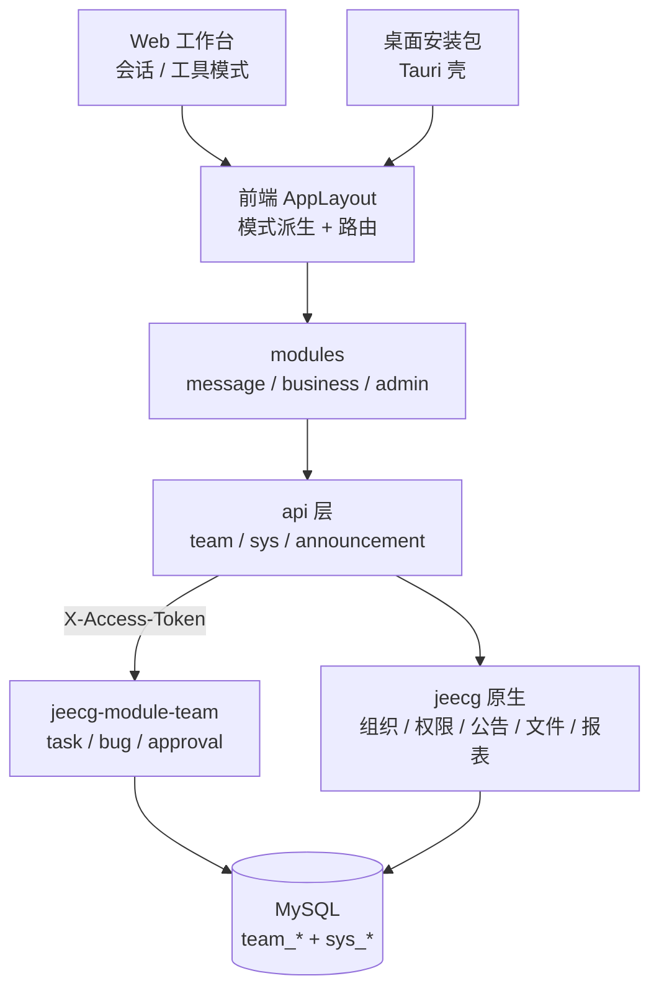
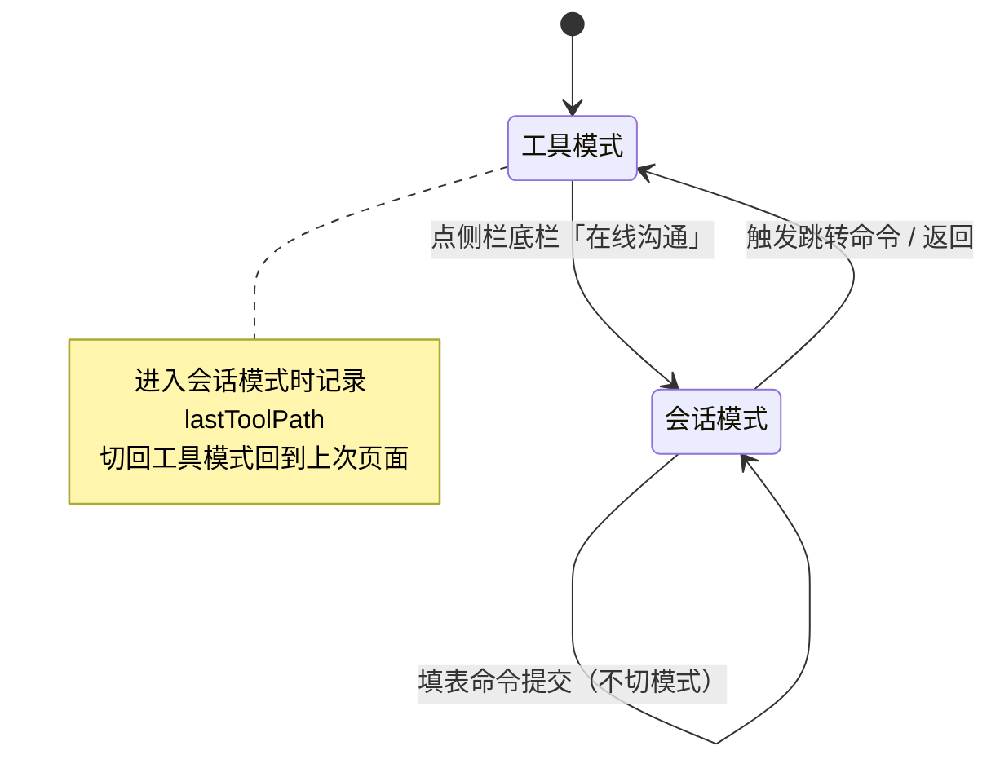
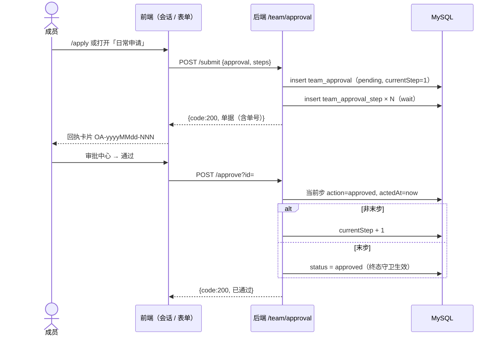
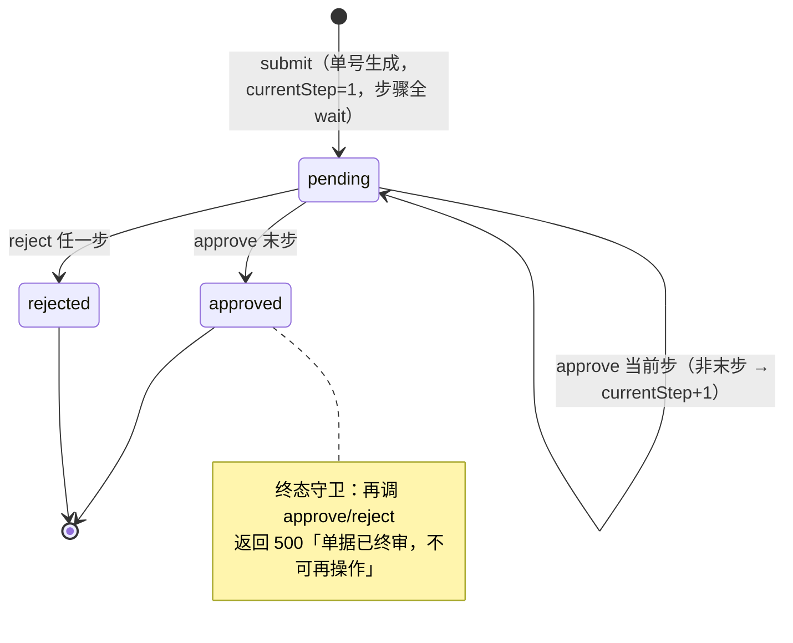
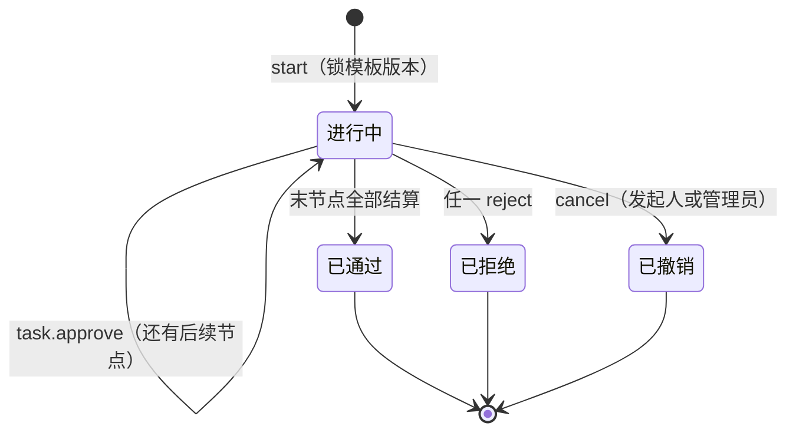

| 项目 | 内容 |
|---|---|
| 文档版本 | **V3.2**（md 主稿，docx 由本文件导出） |
| 编制日期 | 2026-11-17 |
| 密级 | 项目组内部（含真实分工与审计发现，勿外传） |
| 编制 | Kimi Code |
| 审阅 | 周景潇（技术负责人） |
| 适用范围 | 立项评审 / 开发实施 / 联调验收 |
| 配套文档 | 《团队协作效率工作台接口文档 V3.2》（下称"接口文档"） |

> **V3.2 变更要点**：① 文档改为 md 主稿、docx 由 md 导出，消除双源漂移；② 功能需求由叙述段改为可验收的用例表（UC）；③ 新增状态机、端到端验收场景、可测非功能指标；④ 审计章按运行实例实测结果复核，修正"所有接口 code=200"的口径错误，新增 F-09/F-10 两项发现。

---

## 目录

1. [文档说明](#1-文档说明)
2. [背景与目标](#2-背景与目标)
3. [角色、权限与分工](#3-角色权限与分工)
4. [总体设计](#4-总体设计)
5. [功能需求](#5-功能需求)
6. [关键业务规则](#6-关键业务规则)
7. [状态机与数据设计](#7-状态机与数据设计)
8. [非功能需求](#8-非功能需求)
9. [验收口径](#9-验收口径)
10. [演进路线与登记项](#10-演进路线与登记项)
11. [需求符合性审计](#11-需求符合性审计)
12. [风险与未决决策](#12-风险与未决决策)
13. [附录](#13-附录)

---

# 1 文档说明

## 1.1 目的与读者

本文件定义"团队协作效率工作台"的产品需求、业务规则、数据与验收口径。三类读者按不同方式使用：

| 读者 | 读法 |
|---|---|
| 技术负责人 / 裁决人 | 第 6 章规则、第 10 章登记项、第 11 章审计 —— 用于裁决范围与优先级 |
| 开发成员 | 第 5 章用例 + 接口文档对应章节 —— 直接开工，不必先读代码 |
| 汇报对象（外部） | 第 2~4 章、第 8 章、第 9 章 —— 已脱敏，不含真实姓名与内部代号 |

## 1.2 范围

**本系统做什么**：以开源低代码平台 JeecgBoot 3.9.6 为底座，建设面向"人机混编团队"的协作工作台 —— 会话与工作台双入口、可配置审批流程、结构化工具回执、助手治理与注意力分级。

**本系统不做什么**（明确排除，避免范围蔓延）：

| 排除项 | 理由 |
|---|---|
| 自研 IM 底层 | 消息通路复用成熟 IM 组件（里程碑 M2），不自研协议 |
| 自研 BPM 引擎 | 轻量模板 + 条件路由已覆盖当前形态，不上 Flowable 编排 |
| 微服务拆分 | 目标规模下单体富余一个量级，瓶颈在交互与治理（见 [docs/18](../docs/18-strategy-60p60a.md)） |
| 分布式组件 / 消息队列 | 同上；引入即为过度设计 |
| 账号池 / 浏览器池 / AI 采集 | 封存研究线，未经技术负责人拍板不重启 |
| 移动端原生 App | Web 响应式 + 桌面安装包已覆盖交付形态 |

## 1.3 状态标记

全文统一三种标记，出现在用例、功能、接口、表结构各处：

| 标记 | 含义 | 判定标准 |
|---|---|---|
| **✅ 已实现** | 代码在役且运行级验证过 | 本机实例实测返回符合预期 |
| **🧩 设计中** | 合同已定稿、代码未写 | 接口文档已给出请求/响应契约 |
| **📋 规划** | 仅登记，方案未定 | 仅在第 10 章存在，不得开工 |

## 1.4 变更记录

| 版本 | 日期 | 变更 | 变更人 |
|---|---|---|---|
| V1.0 | 2026-11-16 | 初版需求（含账号池等封存线内容） | Kimi Code |
| V2.0 | 2026-11-17 | 方向重定为"团队协作效率工具"，剔除封存线 | Kimi Code |
| V3.0 | 2026-11-17 | 目标场景升级为人机混编（60 人 + 60 助手）；新增流程编排、人机治理、决策记录 | Kimi Code |
| V3.1 | 2026-11-17 | + 真实分工 + 符合性审计 F-01~F-08（docx 增量版） | Kimi Code |
| **V3.2** | 2026-11-17 | 结构重写为 md 主稿；需求改为用例化；修正响应码口径；审计按实测复核并新增 F-09/F-10 | Kimi Code |

## 1.5 相关文档

| 文档 | 位置 | 用途 |
|---|---|---|
| 接口文档 V3.2 | `deliverables/` | 18 个已实现接口 + 原生依赖域代码级合同 + 设计中域契约 |
| docs/13 团队上手指南 | `docs/` | 环境搭建、分支纪律、提交流程 |
| docs/16 后端模块设计 | `docs/` | 页面 ↔ 后端映射、自研表与复用矩阵 |
| docs/18 战略重估 | `docs/` | 60+60 场景难点与分阶段路线 |
| docs/17 VM 工作空间 | `docs/` | 在线接口文档实例与成员使用方式 |

---

# 2 背景与目标

## 2.1 业务痛点

当 AI 助手以"一人一位"进入组织，协作从"纯人类团队"变成"人机混编团队"。三类新痛点：

1. **注意力通胀**：助手产出能力强，消息与草稿若直接涌入频道，人类注意力被稀释到无法决策 —— "助手太能产出"比"助手不够能干"更危险。
2. **信任与授权**：每条自动化动作需要可审计凭据与清晰的授权边界（可自动 / 需确认 / 禁止），无边界自动化等于事故。
3. **协作拓扑从"链"变"网"**：跨部门会签、金额条件路由、代审委托、批量决策、异步超时成为常态，传统两级审批链表达不了。

同时普通团队存在长期未被满足的基本面：流程工具重、实施周期长、消息与审批割裂，高频事务（报销、请假、采购、活动经费）缺"一句话办完"的入口。

## 2.2 场景规模

| 维度 | 目标值 | 依据 |
|---|---|---|
| 成员 | 人类 60 名 + 助手 60 个（1:1 配比） | 高管/科学家团队典型形态 |
| 消息量 | 日万级 | 60 助手 × 日常回执与摘要 |
| 流程实例 | 千级在途+归档 | 60 人日常审批与评审 |
| 权限粒度 | 组织/角色/按人三类 | 底座 RBAC + 代表关系跟随 |

## 2.3 产品定位

| 对比维度 | 普通 OA | IM + 机器人 | Agent 平台 | **本系统** |
|---|---|---|---|---|
| 入口形态 | 菜单层级深 | 消息即入口 | 对话即入口 | 会话命令 + 工作台双通道，路径最短 |
| 流程能力 | 有但僵化 | 基本没有 | 基本没有 | 模板 + 条件路由 + 会签 + 委托 |
| 自动化可信 | 不涉及 | 黑盒 | 黑盒 | 工具调用结构化留痕 + 授权三级 |
| 人机混编治理 | 不涉及 | 不涉及 | 弱（无组织语境） | 助手身份 / 代表关系 / 策略 / 审计 |
| 注意力治理 | 不涉及 | 弱 | 弱 | 订阅分级 + 每日摘要 |
| 交付形态 | 重实施 | 轻但无流程 | 技术件 | 单体 + Web + 桌面安装包 |
| 文档契约 | 手工维护 | 无 | 不一 | 随代码生成，主线每日同步 |

## 2.4 设计主张与取舍

**主张**：路径最短、过程透明、授权有界、部署最轻。

**取舍**（有意识的放弃，不是遗漏）：

| 取舍 | 代价 | 换取 |
|---|---|---|
| 不上 BPM 引擎，用 JSON 模板 | 复杂流程（多级回退、动态加签）表达不了 | 上手快、可读、无需专业建模工具 |
| 条件表达式只支持金额阈值与类别匹配 | 首期表达力有限 | 服务端求值简单可控，无脚本注入面 |
| 消息通路复用 IM 组件 | 受组件能力边界约束 | 省掉 IM 底层自研 |
| 单体部署 | 单点故障 | 零额外组件、桌面安装包可直接内置 |
| 桌面壳暂用 Tauri 直连本机后端 | 无远程多租户 | 单机/小团队零运维 |

---

# 3 角色、权限与分工

## 3.1 角色画布

| 角色 | 核心诉求 | 系统提供的抓手 |
|---|---|---|
| **决策层成员**（负责人/高管） | 用最少时间处理最多决策 | "今日待决"按截止时间聚合、批量审批、代审委托、每日摘要 |
| **专业成员**（业务/工程） | 提交、跟踪、会签 | 提交表单 + 进度链路 + 命令入口 |
| **普通成员**（降配场景） | 零培训办完事 | 默认模板包 + `/apply` 命令 |
| **助手**（受治理参与者） | 执行任务且不越权 | 身份档案 + 代表关系 + 策略三级 + 审计留痕 |
| **管理运营**（模块负责人/管理员） | 组织数据唯一出口、发布通道 | 管理域 CRUD、公告、文档服务 |

## 3.2 权限矩阵

**目标态**（设计口径）：

| 动作 | 决策层 | 专业成员 | 普通成员 | 助手 | 管理员 |
|---|---|---|---|---|---|
| 提交申请 | ✓ | ✓ | ✓ | 仅 auto 级且代表人授权 | ✓ |
| 审批他人单据 | 仅本人步骤 | 仅本人步骤 | — | 代审仅在委托有效期内 | 全部（留痕） |
| 管理组织/人员数据 | 只读 | 只读 | 只读 | 跟随代表人 | 写 |
| 配置助手策略 | — | — | — | 不可自配 | 写 |
| 删除单据 | 本人发起 | 本人发起 | 本人发起 | — | 全部 |

**当前实现**（诚实差距）：团队域三个控制器均未接 `@RequiresPermissions`，**任何登录用户可读写全部 /team/** 接口**，删除/编辑不校验归属 —— 见第 11 章 F-09。RBAC 矩阵为设计口径，实现排在 R-01 之后。

## 3.3 真实分工（内部）

| 成员 | 账号 | 负责域 | 近期主线 |
|---|---|---|---|
| 周景潇（技术负责人） | juice094 | 业务域 + 工具域 + 合同裁决 | R-01 流程模板化、R-02 今日待决、R-03 决策记录 |
| 杨怡 | Ym3699 | 管理域（人事/行政/教务/后勤） | 人事按 orgCode 精确过滤；R-09 管理域三表立项 |
| 杨润泽 | qingyanjunzi | 会话工作台 + 消息域 | R-04 消息通路（M2）、R-05 摘要、R-08 命令参数化 |
| Kimi Code（AI 助手） | — | 公共层收口 / 后端骨架 / 运维 | 按 STATUS 接手清单执行，产出由技术负责人 review |

**协作纪律**：分支从 `pilot/w1-trim` 切；一 PR 一事；描述带"文档影响"；不引入封存线内容；不写实公司/人物名（内部版除外）；外部代号不进文档。

---

# 4 总体设计

## 4.1 系统构成



## 4.2 域划分与交付状态

| 域 | 载体 | 状态 | 说明 |
|---|---|---|---|
| 基座域 | 前端 AppLayout/Sidebar/设计令牌 | ✅ | 双模式、菜单单一来源、统一 HTTP 出口 |
| 概览域 | `views/dashboard` | ✅（聚合接口待建） | 待决/我的申请/公告，N 次往返待合并 |
| 工具域 | `modules/business` + `/team/**` | ✅ | 申请/审批/反馈/上传/报表；工作邮箱后置 |
| 管理域 | `modules/admin` + `/sys/**` | ✅ 基线 | 人事已接真接口；行政/教务/后勤待立项 |
| 业务域 | `modules/business` 三页 | 📋 | 市场/职教/学生服务，表待设计 |
| 会话与消息域 | `modules/message` | ✅ 壳层 / 🧩 治理 | 命令面板、回执卡片、会话内表单；消息通路待 M2 |
| 流程编排域 | 待建 `jeecg-module-team` 扩展 | 🧩 | 模板/实例/任务/委托/决策，本期主战场 |
| 人机治理域 | 待建 | 🧩 | 助手档案、策略引擎、审计检索 |

## 4.3 双模式交互模型

工作台有两种布局，模式由路由单向派生（不双向同步，避免状态打架）：

- **工具模式**：左侧菜单树（概览/管理/业务/工具共 14 页），适合完整操作。
- **会话模式**：对话流 + 斜杠命令 + 会话内表单卡，适合一句话办完。



**关键约束**：`/message` 只有一套渲染路径（chat 分支），不存在"消息页套工具布局"的分裂实现。

## 4.4 端到端数据流（以一次加班申请为例）



---

# 5 功能需求

用例编号规则：`UC-<域>-<序号>`。每张表给主流程与验收口径，**验收口径可判定**才算合格需求。

## 5.1 基座域

| 编号 | 用例 | 主流程 / 规则 | 验收口径 | 状态 |
|---|---|---|---|---|
| UC-B-01 | 双模式切换 | 侧栏底栏切换会话/工具；模式由路由派生；记 lastToolPath | 切换 3 次后回到上次工具页；同一路由不出现双布局 | ✅ |
| UC-B-02 | 菜单单一来源 | 菜单配置一份数据源，侧栏与路由同源 | 新增一页只改一处配置即可出现在菜单与路由 | ✅ |
| UC-B-03 | 统一鉴权出口 | 前端 http 出口注入 token；Tauri 形态直连绝对地址 | Web 走代理、桌面直连均能登录成功；401 统一提示 | ✅ |

## 5.2 概览域

| 编号 | 用例 | 主流程 / 规则 | 验收口径 | 状态 |
|---|---|---|---|---|
| UC-O-01 | 查看待决与我的申请 | 两个分页视图：`status=pending`、`applicantId=本人` | 待决数与审批中心 pending 页一致 | ✅ |
| UC-O-02 | 查看系统公告 | `listByUser` 取 `anntMsgList`（Map 结构） | 有公告时不出现空态；无公告显示空态文案 | ✅（F-01 已修） |
| UC-O-03 | 今日待决聚合 | 单接口一次返回 待办数/公告/未读/任务数 | 首页由 N 次请求降为 1 次，≤2 秒 | 🧩 R-02 |

## 5.3 工具域

| 编号 | 用例 | 主流程 / 规则 | 验收口径 | 状态 |
|---|---|---|---|---|
| UC-T-01 | 提交申请 | 填类别/标题/事由/起止 → 生成单号 → 两步审批链 | 提交成功返回单号；审批中心可见 pending 记录 | ✅ |
| UC-T-02 | 逐级审批 | 通过当前步骤 → 非末步推进 → 末步整单通过 | 两步单据通过后 status=approved 且不可再操作 | ✅ |
| UC-T-03 | 拒绝 | 任一步拒绝 → 整单 rejected | 拒绝后当前步骤 action=rejected，单据终态 | ✅ |
| UC-T-04 | 步骤链追溯 | 按单号查步骤链（人/角色/意见/时间） | 两步单据返回 2 条按 stepNo 升序 | ✅ |
| UC-T-05 | 问题反馈 | 描述必填，提交后 open → processing → resolved/closed | 提交后列表出现且状态 open；流转后状态更新 | ✅ |
| UC-T-06 | 资料上传 / 个人报表 | 上传走 `sys/common/upload`；报表嵌 JimuReport | 上传返回相对路径；报表页带 token 可打开 | ✅ |
| UC-T-07 | 工作邮箱 | SMTP 自建 vs 后置决策 | 决策未定不开工 | 📋 R-11 |

## 5.4 管理域

| 编号 | 用例 | 主流程 / 规则 | 验收口径 | 状态 |
|---|---|---|---|---|
| UC-M-01 | 部门树浏览 | `queryTreeList` 返回树数组（children 嵌套） | 树可展开到末级，节点带 orgCode | ✅ |
| UC-M-02 | 成员列表按部门过滤 | 按 orgCode 精确过滤成员 | 选中部门后只显示该部门成员 | ✅ 基线（精确过滤待增强） |
| UC-M-03 | 行政/教务/后勤 | 固定资产/排课/报修三表（Ym3699 立项） | 三表 CRUD + 与审批状态机对接 | 📋 R-09 |

## 5.5 业务域

| 编号 | 用例 | 主流程 / 规则 | 验收口径 | 状态 |
|---|---|---|---|---|
| UC-S-01 | 市场活动登记 | 活动 CRUD + 经费走审批 | 活动可关联审批单 | 📋 R-09 |
| UC-S-02 | 职业教育培训班 | 班期/学员/结业 | 班期可关联学员与考勤 | 📋 R-09 |
| UC-S-03 | 学生服务（学籍异动） | 异动类型即审批类别，复用审批状态机 | 提交异动后进度可跟踪，无需新建表 | 🧩 |

## 5.6 会话与消息域

| 编号 | 用例 | 主流程 / 规则 | 验收口径 | 状态 |
|---|---|---|---|---|
| UC-C-01 | 斜杠命令面板 | 输入 `/` 唤起；navigate 型跳页，form 型开会话内表单 | `/approve` 跳工具模式审批中心并切模式 | ✅ |
| UC-C-02 | 工具循环回执 | 助手消息携带 toolCalls（标识/参数/状态/耗时/返回） | 回执卡片可展开，字段齐全 | ✅ |
| UC-C-03 | 会话内填表 | QuickFormCard 提交直达 `/team/approval`、`/team/bug` | 提交后落库，单号可查 | ✅ |
| UC-C-04 | 消息通路 + 订阅分级 | IM 组件接入；频道三档订阅；助手消息默认折叠 | 120 账号并发无丢失；助手消息 100% 折叠不占未读 | 🧩 R-04 |

## 5.7 流程编排域（本期主战场）

| 编号 | 用例 | 主流程 / 规则 | 验收口径 | 状态 |
|---|---|---|---|---|
| UC-F-01 | 流程模板定义 | JSON 声明 seq/sign/cond 节点；模板版本化 | 改模板不影响在途实例 | 🧩 |
| UC-F-02 | 发起实例 | 锁模板版本 → 求值条件 → 生成首批任务 | 金额分支按阈值走对分支；任务落具体人 | 🧩 |
| UC-F-03 | 会签结算 | any=首个通过即流转；all=全部通过；任一拒绝整单拒绝 | 三节点会签 any 下 1 人通过即流转 | 🧩 |
| UC-F-04 | 委托代审 | 时间段 + 范围授权；任务在受托人待决可见；有向无环校验 | 循环委托被拒；受托处理留实际处理人 | 🧩 |
| UC-F-05 | 批量审批 + 今日待决 | 20 条批量逐条校验逐条落痕，返回逐条结果 | 20 条批量 ≤1 分钟，部分失败不影响其余 | 🧩 R-01/R-02 |
| UC-F-06 | 决策记录 | 背景/选项/结论/反对意见，可挂接单据与讨论 | 审批详情可挂接决策记录，三维检索可查 | 🧩 R-03 |

**与现有两级审批的关系**：现有 `team_approval` 保留为"单线模板特例"，历史数据不迁移、接口兼容。新模板体系上线后，前端"日常申请"的固定两步链改为模板实例化，UI 与接口不变。

## 5.8 人机治理域

| 编号 | 用例 | 主流程 / 规则 | 验收口径 | 状态 |
|---|---|---|---|---|
| UC-A-01 | 助手档案 | 代表人、能力声明、数据范围、配额 | 助手数据可见范围 = 代表人范围，不可自扩 | 🧩 R-06 |
| UC-A-02 | 策略三级 | 按工具配置 auto/confirm/deny；金额与对外承诺禁 auto | 调用携带策略判定；deny 不可执行 | 🧩 R-06 |
| UC-A-03 | 审计检索 | 按助手/人/工具三维检索调用记录 | 缺 principalId 的调用被拒绝并留痕 | 🧩 R-07 |
| UC-A-04 | 注意力治理 | 助手产出折叠为回执，按人聚合每日摘要 | 确认项在摘要中单列 | 🧩 R-05 |

---

# 6 关键业务规则

规则编号 `BR-xx`，开发与评审以本表为裁判依据；冲突时技术负责人裁决并改本表。

| 编号 | 规则 | 判定方式 |
|---|---|---|
| BR-01 | 模板版本化：实例锁定发起时模板版本，模板变更不影响在途实例 | 实例表存 version 快照字段 |
| BR-02 | 条件路由在服务端求值，表达式只访问表单字段 | 表达式求值器不持有外部数据源 |
| BR-03 | 会签 any=首个通过即流转；all=全部通过；任一拒绝即整单拒绝 | 结算逻辑单测覆盖三种路径 |
| BR-04 | 委托有向无环：新增委托时校验图，禁循环 | 校验失败返回业务错误 |
| BR-05 | 实例终态（approved/rejected/cancelled）后任何节点操作被拦截 | 服务层先判状态再改步骤（已实现） |
| BR-06 | 单号 `OA-yyyyMMdd-NNN`（当日三位序号），唯一索引兜底 | DB 唯一索引 + 冲突时报错不重试 |
| BR-07 | 提交与节点落库同事务；必填校验在服务边界 | `@Transactional(rollbackFor=Exception.class)` |
| BR-08 | 批量审批逐条校验、逐条落痕，部分失败不影响其余，返回逐条结果 | 响应体含逐条 code/message |
| BR-09 | 地址参数含中文必须 URL 编码（Tomcat 拒绝未编码裸中文） | 联调用例带中文意见必须编码 |
| BR-10 | 列表过滤为**精确匹配**（团队域全字段 eq），不做模糊；排序见 BR-11 | 见审计 F-07，实测依据 |
| BR-11 | 任务列表 `sort_no` 升序 + `create_time` 降序；审批/反馈列表 `create_time` 降序 | 接口文档响应示例可核 |
| BR-12 | 助手调用必须携带 principalId 与策略判定结果，缺失拒绝执行 | 服务端强制校验，非前端校验 |
| BR-13 | 助手消息默认折叠、不占未读；结论归属人类；助手输出标注来源 | 消息渲染层不进未读计数 |
| BR-14 | 组织/人员数据只经管理域出口读取，其他域不得自建人员表 | 代码评审检查项 |
| BR-15 | 菜单/路由以配置为唯一权威；枚举字典化 | 新增页面只改一处配置 |

---

# 7 状态机与数据设计

## 7.1 审批状态机（✅ 已实现）



步骤动作：`wait`（未处理）→ `approved` / `rejected`。步骤链只追加记录，不删除、不改历史。

## 7.2 流程实例 / 任务状态机（🧩 设计）



任务状态：`todo` → `doing`（可选，认领）→ `done`；委托任务可在受托人待决中出现，处理人记实际处理者。

## 7.3 数据表

### 7.3.1 已落地（Flyway V3.9.6_2 / V3.9.6_3）

| 表 | 用途 | 关键字段 | 备注 |
|---|---|---|---|
| `team_task` | 任务协作 | title, description, status(todo/doing/done), tag, priority(高/中/低), assignee_id/name, due_date, sort_no | 看板列内排序 |
| `team_approval` | 审批单 | code(唯一), category, title, reason, status(pending/approved/rejected), applicant_id/name, start_date, end_date, current_step | 单号 `OA-yyyyMMdd-NNN` |
| `team_approval_step` | 审批步骤链 | approval_id, step_no, approver_name, approver_role, action(wait/approved/rejected), comment, acted_at | 无 approver_id（F-02 根因） |
| `team_bug` | 问题反馈 | description, screenshot_path, status(open/processing/resolved/closed), reporter_id/name, handler_name | 状态流转无枚举校验 |

字段级定义（类型/必填/默认值/来源）以接口文档第 3 章为准，两处不重复维护。

### 7.3.2 设计中

| 表 | 用途 | 关键字段 |
|---|---|---|
| `team_flow_def` | 流程模板 | code, name, nodes(JSON), version, status |
| `team_flow_inst` | 流程实例 | def_code, def_version, applicant, current_node, status, started_at |
| `team_flow_task` | 流程任务 | inst_id, node_key, assignee_id, status, comment, due_at, done_at, acted_by |
| `team_flow_delegate` | 委托代审 | from_user, to_user, start_at, end_at, scopes, status(active/expired/revoked) |
| `team_decision` | 决策记录 | background, options, conclusion, objections, related_biz, owner_id |
| `agent_profile` | 助手档案 | user_id, principal_id, capabilities(JSON), data_scope, quota |
| `agent_policy` | 授权策略 | agent_id, tool_id, level(auto/confirm/deny), updated_by |

### 7.3.3 复用底座数据

组织/人员/角色/字典/公告/站内消息/文件/报表全部复用 `sys_*` 模型；助手身份复用 `sys_user` 加档案扩展，不复制人员主数据。

---

# 8 非功能需求

指标可测，验收时按此表逐条打勾。

| 编号 | 类别 | 指标 | 验收方式 |
|---|---|---|---|
| NFR-01 | 性能 | 常规列表接口 P95 ≤1 秒（千级数据） | 接口压测或日志耗时统计 |
| NFR-02 | 性能 | 今日待决聚合视图 ≤2 秒 | 前端打点 + 接口耗时 |
| NFR-03 | 性能 | 在线接口文档全量加载 ≤5 秒 | 浏览器实测 |
| NFR-04 | 容量 | 120 账号、日万级消息、千级实例无功能退化 | 压测或阶段汇报 |
| NFR-05 | 安全 | 所有业务接口要求登录令牌；缺失或失效返回 401 | `curl` 无 token 实测 |
| NFR-06 | 安全 | 敏感域（薪酬/评审/预算）按角色隔离，导出留痕 | 角色账号交叉访问实测 |
| NFR-07 | 安全 | 工具调用与消息渲染隔离，指令只来自服务端策略 | 注入用例（消息文本含伪指令）不改变执行 |
| NFR-08 | 可靠 | 提交与步骤落库同事务，中途失败不产生半截数据 | 事务回滚用例 |
| NFR-09 | 可靠 | 终态守卫：终态单据任何操作被拒 | 实测返回 500 + 明确文案 |
| NFR-10 | 可审计 | 单据留痕（人/意见/时间）、工具调用留痕、决策记录齐全 | 查询步骤链与审计页 |
| NFR-11 | 可维护 | 新域接入四步（迁移 + 实体/映射/服务/控制器 + 文档登记），不超 1 天 | 以本次 team 模块为样本 |
| NFR-12 | 兼容 | 桌面安装包可在 Windows 11 直接安装运行 | NSIS 安装包冒烟 |
| NFR-13 | 文档 | 接口文档随主线每日同步，doc.html 与仓库文档口径一致 | 每日 05:30 自动更新任务 |

---

# 9 验收口径

## 9.1 验收三问

每个功能交付时回答，答不全不合并：

1. **能用吗** —— 目标角色能在真实环境完成主流程（不是接口返回 200 了事）？
2. **可审计吗** —— 谁在什么时候做了什么，事后能查出来？
3. **边界清楚吗** —— 失败、越权、终态、并发四种情形有明确行为？

## 9.2 端到端验收场景

| 编号 | 场景 | 步骤 | 实测结果（2026-11-17） |
|---|---|---|---|
| E2E-01 | 双模式切换 | 工具页 → 在线沟通 → 返回 | ✅ 通过（CDP 自动化） |
| E2E-02 | 命令跳转 | 会话输入 `/approve` | ✅ 通过（自动切模式并跳转） |
| E2E-03 | 会话内填表 | `/apply` 填表提交 | ✅ 通过（落库 OA-20261116-003） |
| E2E-04 | 两步审批全通过 | 提交 → 通过 → 通过 | ✅ 通过（status=approved，二次操作被拒） |
| E2E-05 | 拒绝路径 | 提交 → 拒绝 | ✅ 通过（status=rejected） |
| E2E-06 | 公告解析 | 概览页拉公告 | ✅ 通过（Map 结构已修正，无公告时空态正确） |
| E2E-07 | 人事页真数据 | 部门树 + 成员列表 | ✅ 通过（21 部门 / 成员分页正常） |
| E2E-08 | 桌面安装包 | 安装 → 启动 → 登录 → 首屏 | ✅ 通过（NSIS 冒烟） |
| E2E-09 | 越权审批 | 用他人账号审批非本人步骤单据 | ❌ **未通过**（系统允许，F-02） |

---

# 10 演进路线与登记项

登记项是规划能力的**唯一事实源**，未登记不得开工。状态变更须同步本表与 STATUS。

| 编号 | 事项 | 负责域 | 状态 | 依赖 | 验收口径 |
|---|---|---|---|---|---|
| R-01 | 流程模板化 + 会签/委托/超时/批量 | 流程域（周景潇） | 🧩 设计中 | 无 | 跨域会签跑通；20 条批量 ≤1 分钟 |
| R-02 | 今日待决视图 + 仪表盘聚合接口 | 业务域 | 🧩 设计中 | R-01 | 按截止时间排序，一次拉起计数 |
| R-03 | 决策记录实体与挂接 | 流程域 | 🧩 设计中 | R-01 | 审批/评审可挂接，三维检索 |
| R-04 | 消息通路 + 订阅分级 | 消息域（杨润泽） | 🧩 里程碑 M2 | IM 组件选型 | 120 并发无丢失；助手消息 100% 折叠 |
| R-05 | 每日摘要 digest | 消息域 | 📋 规划 | R-04 | 按人聚合，确认项单列 |
| R-06 | 助手档案 + 策略引擎 | 治理域 | 🧩 设计中 | 无 | 调用 100% 携带代表人/策略 |
| R-07 | 审计检索面（三维） | 治理域 | 📋 规划 | R-06 | 策略缺失即拒绝执行 |
| R-08 | 命令参数直提 + 角色裁剪 | 消息域 | 📋 规划 | R-04 | `/apply 报销 打车费 86` 一步提交 |
| R-09 | 业务域三页 + 管理域三表 | 业务/管理域（杨怡） | 📋 立项中 | 表设计 | 学生服务以流程模板实现 |
| R-10 | 默认模板包（报销/请假/采购/活动/值班） | 流程域 | 📋 规划 | R-01 | 开箱即用，零配置 |
| R-11 | 工作邮箱 | 技术负责人 | 📋 待决策 | 邮件服务选型 | SMTP 自建或后置明确 |
| R-12 | 桌面壳版本化（签名/自动更新） | 技术负责人 | 📋 规划 | — | 安装包版本号可升级 |

**优先级**：R-01 → R-02 → R-03 → R-04 → R-06。R-01 未完成前，其他流程相关事项不开工。

---

# 11 需求符合性审计

**方法**：以运行实例（`127.0.0.1:8081`，配置 `pilot/w1-trim`）为真身，逐项核对 OpenAPI（`/v3/api-docs`）→ 控制器代码 → 前端 api 层三者一致性。下表"证据"列的结论均可复现。

| 编号 | 发现 | 证据（可复现） | 影响 | 整改 | 责任人 | 状态 |
|---|---|---|---|---|---|---|
| F-01 | 前端公告解析与实际返回不符：`listByUser` 返回 Map（`anntMsgList/anntMsgTotal/sysMsgList/sysMsgTotal`） | `curl /sys/annountCement/listByUser` → `result` 为对象非数组 | 概览公告恒空，功能形同虚设 | 已改 `api/announcement.ts` 取 `anntMsgList` | 业务域 | ✅ 已修 |
| F-02 | 审批 approve/reject 不校验操作人：任意登录用户可审批任意单据任意步骤 | 控制器无操作人比对；步骤表无 `approver_id` | 越权审批，审计失效 | R-01 范围内：步骤表加审批人标识 + 操作人校验；过渡期接口层加当前人校验 | 业务域 | 🧩 未修 |
| F-03 | doc.html 覆盖缺口：在用原生接口未进入 OpenAPI | `v3/api-docs` 共 170 条路径，`/team/**` 18 条，`/sys/user/list`、`/sys/annountCement/listByUser`、`/sys/common/upload`、`/sys/message/**`、`/sys/sysDepart/queryTreeList` 均不存在 | 接口合同不完整，新成员无法据文档联调 | 短期以接口文档"代码级合同"章节兜底（已落）；中期修 springdoc 扫描/排除配置 | Kimi Code | 🧩 兜底已落 |
| F-04 | 接口数口径错误：团队域实际 18 个（任务 6 + 反馈 6 + 审批 6），非 21 | `v3/api-docs` 中 `/team/*` 精确计数 18 | 统计口径错误，误导工作量评估 | V3.2 已修正 | Kimi Code | ✅ 已修 |
| F-05 | 侧栏徽标写死（审批 34 / 邮箱 3） | 菜单配置常量硬编码 | 演示数据进功能 | 接真实计数（公告未读 + 待决数）前移除徽标 | 消息域 | 🧩 未修 |
| F-06 | 审批 `comment` 中文走 URL 触发 Tomcat 400 | 未编码中文查询参数被容器拒绝 | 联调易踩坑 | 文档已标 BR-09；建议 comment 改请求体 | 业务域 | ✅ 已标注 |
| F-07 | 列表过滤语义误解：团队域为**全字段精确匹配**，无模糊 | `?category=加班` → total 0；`?category=加班申请` → 2；`?title=CDP` → 0 | 前端"按标题搜索"会得到空结果 | 文档按 BR-10 明确；确需模糊时显式声明 | 业务域 | ✅ 已标注 |
| F-08 | `listByUser` 的 `pageSize` 默认 5，时间窗只到**上月 1 日**起 | 代码依据：`DateRangeUtils.getLastMonthStartDay()` | 与"系统公告全量"预期不符 | 前端显式传 `pageSize=50`；需更早历史改用 `/list` + 权限过滤 | 业务域 | ✅ 已规避 |
| **F-09** | 团队域零权限控制：三个控制器均未加 `@RequiresPermissions`，任何登录用户可增删改任意单据，删除/编辑不校验归属 | 代码核对：`TeamTaskController`/`TeamBugController`/`TeamApprovalController` 无权限注解；`delete` 直接按 id 删除 | 越权删除/篡改，多团队共用时风险高 | 接入按钮权限编码（team:task:add/edit/delete…）+ 归属校验；列入 R-01 强制范围 | 业务域 | 🧩 新增 |
| **F-10** | 站内消息接口不可用：`/sys/message/sysMessage/list` 返回 510 无权限 | `curl` 带 admin token → `{"code":510,"message":"没有权限，请联系管理员分配权限！"}` | 收件箱接入即碰壁 | 分配菜单/按钮权限后再接入（M2 前置检查项） | 消息域 | 🧩 新增 |

**审计口径补充**：本表只记"文档与代码/运行实例不符"的问题；纯设计缺口记入第 10 章登记项，不占审计编号。

---

# 12 风险与未决决策

| 编号 | 事项 | 风险 | 待谁拍板 | 建议 |
|---|---|---|---|---|
| D-01 | 工作邮箱：SMTP 自建 or 后置 | 影响工具域完整性 | 技术负责人 | 先做决策再开工，避免返工 |
| D-02 | 资料中心存储：MinIO or 本地 | 影响表设计与迁移 | 技术负责人 | 目标规模下本地存储够用，MinIO 待 M2 |
| D-03 | 消息通路选型（IM 组件） | R-04 阻塞点 | 技术负责人 | 先定组件再排期，否则 M2 无法启动 |
| D-04 | 桌面壳分发方式（内网 / 签名） | 影响 R-12 | 技术负责人 | 内网分发先行，签名后置 |

**风险**：F-02/F-09 使当前系统在多成员真实使用下不可信（越权审批与越权删除）。**建议 R-01 前置一个"最小权限补丁"里程碑**，不等待完整流程引擎。

---

# 13 附录

## 13.1 术语

| 术语 | 说明 |
|---|---|
| 双模式工作台 | 会话（聊天）与工具（工作台）两种布局，侧栏底栏切换 |
| 斜杠命令 | 聊天输入 `/` 唤起的命令面板，分跳转型与填表型 |
| 工具循环回执 | 自动化调用的结构化留痕：标识/参数/状态/耗时/返回体 |
| 授权三级 | 自动（留痕执行）/ 需确认（人确认执行）/ 禁止（不可调用） |
| 流程模板 | JSON 声明的节点序列（顺序/会签/条件），版本化 |
| 每日摘要 | 助手产出按人聚合的一份摘要，确认项单列 |
| 登记项 | 规划能力唯一事实源（负责人/状态/验收口径） |
| 代码级合同 | doc.html 未覆盖、以代码与实测返回为准的接口约定 |

## 13.2 页面清单（14 页 + 会话）

| 组 | 页面 | 组 | 页面 |
|---|---|---|---|
| 概览 | 仪表盘 | 业务 | 市场活动 |
| 管理 | 人事管理 | 业务 | 职业教育 |
| 管理 | 行政管理 | 业务 | 学生服务 |
| 管理 | 教务管理 | 工具 | 日常申请 |
| 管理 | 后勤管理 | 工具 | 审批中心 |
| 工具 | 工作邮箱 | 工具 | 资料中心 |
| 工具 | Bug 反馈 | 工具 | 个人报表 |
| 底栏 | 会话工作台 | — | （登录页） |

## 13.3 文档地图

```
deliverables/
  团队协作效率工作台需求规格说明书-V3.2.md   ← 本文件（md 主稿）
  团队协作效率工作台需求规格说明书-V3.2.docx ← 由 md 导出
  团队协作效率工作台接口文档-V3.2.md
  团队协作效率工作台接口文档-V3.2.docx
  HANDOVER.md                                ← 成员入口
  archive/                                   ← V3.0/V3.1 历史呈报件
```
