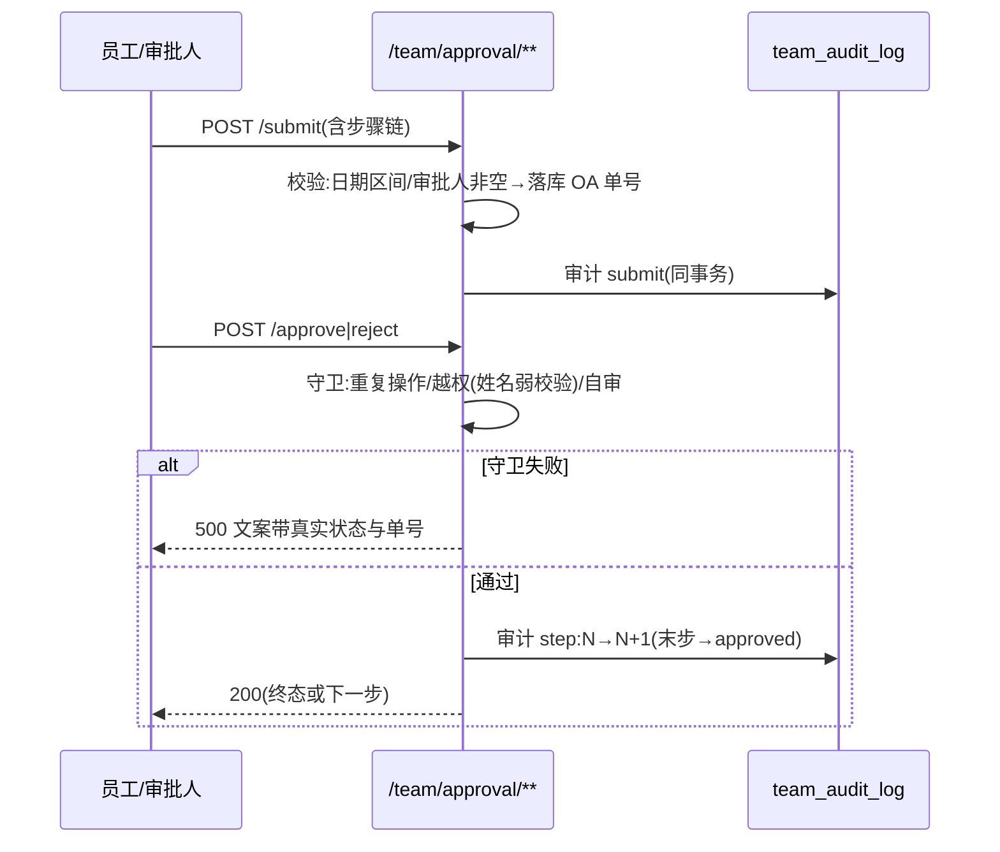
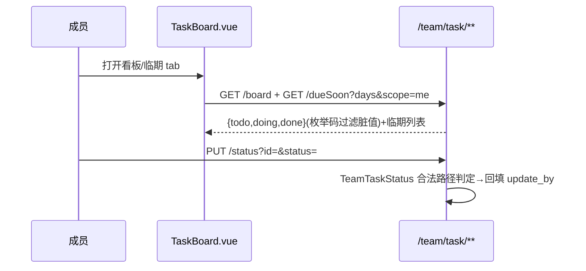
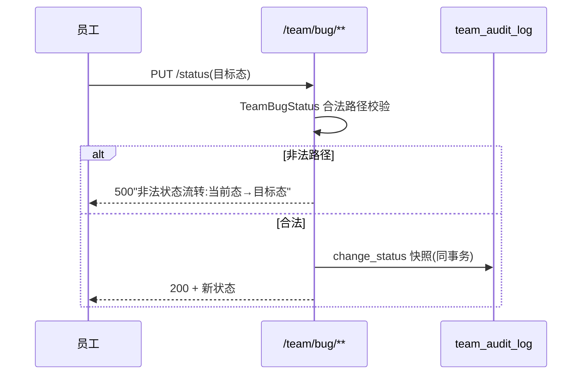
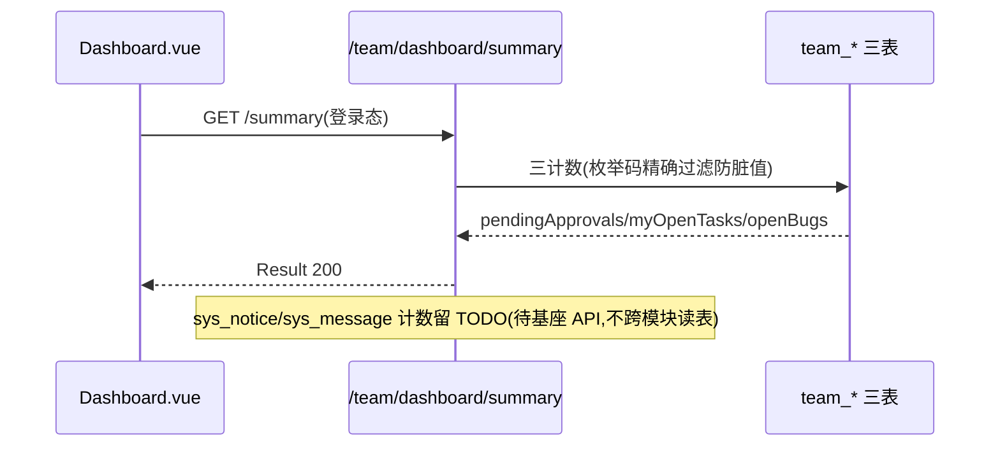

# 团队协作业务线 × 平台基座 需求文档 & 接口文档（v1.0）

> 2026-11-17，juice094 发起，Kimi Code 起草（体例仿《OA 邮件体系 需求文档 & 接口文档 v1.0》）。
> 适用范围：juice094/JeecgBoot fork（pilot/w1-trim），团队协作效率工具的业务模块（任务协作 / 审批 / 日常申请 / Bug / 审计 / 仪表盘聚合）与其所依赖的 JeecgBoot 平台基座能力。
> 定位：**组织内业务与基座的接口合同**。业务模块与基座之间只经本文档声明的 API 与事件，禁止绕过契约直连对方数据表。
> 与既有文档关系：需求细则与 deliverables/ 需求规格说明书 V3.2 同域，本文是其"业务×基座"视角的合同版；智能体团队线见 docs/19~21，不在本文范围。

---

# 第一部分：需求文档

## 1. 背景与目标

团队协作业务的诉求分两类，必须分线设计、分线验收：

| 主线 | 本质 | 典型场景 | 验收口径 |
|---|---|---|---|
| A. 业务状态机线 | 自研轻量业务（jeecg-module-team） | 任务看板流转、请假/报销审批、Bug 处理、操作审计 | 状态流转合法、非法操作被拦截并留痕、审计可查 |
| B. 基座复用线 | JeecgBoot 平台能力编排 | 人员组织（sys_user）、公告（sys_notice）、站内消息（sys_message）、日志（sys_log）、报表（JimuReport） | 不重复造轮子：业务模块只消费基座 API，基座表零写入 |

设计原则：**业务表唯一写者是 team 模块 Service；基座表业务侧只读且经 API；跨线调用禁止跨库 JOIN**。轻量状态机为试点级取舍——不上 Flowable（docs/11 正向道路口径），状态机语义可 later 迁移。

## 2. 范围界定

本期包含（**11-17 宿裁：团队协作与效率工具场景功能整体提前，均为交付主线**）：任务协作（看板/状态机/截止提醒）、审批流（顺序步骤状态机 + 待办查询）、Bug 反馈（状态流转）、操作审计（team_audit_log）、仪表盘聚合（team 侧计数）、与基座的对接契约（人员/公告/消息/日志/定时/迁移/文档）。

本期不包含：重型工作流引擎（Flowable 级，已裁决后置）、自研消息通路（Mattermost 承担，docs/13）、AI 智能体团队（docs/19~21，M4+ 评审）、多级审批（后置）。**表单模板体系已自本期需求移除**（宿 11-17 裁：模板成分占位延后；如需重启走 issue 重新立项，见 D-20261117-68 resolved）。

## 3. 用户角色

| 角色 | 权限 |
|---|---|
| 普通员工 | 建任务/提审批/报 Bug；看本人待办与截止提醒 |
| 审批人 | 处理 steps 中指向本人的审批步骤（当前按姓名匹配，试点级） |
| business owner（juice094） | 接口合同裁决、后端质量把关、聚合口径定版 |
| 系统管理员 | 审计日志查询、后续权限补丁（F-09）实施 |
| 前端（team-web business 模块） | 仅经 `/team/**` REST 消费，不直连数据库 |

## 4. 功能需求

### FR-T 任务协作

| 编号 | 需求 | 优先级 | 验收标准 |
|---|---|---|---|
| T-1 | 任务 CRUD + 看板三态（todo/doing/done） | P0 | 状态码全枚举校验，非法码/自流转抛带上下文异常 |
| T-2 | 状态流转端点（PUT /status） | P0 | 流转合法性由 service 层 TeamTaskStatus 判定，controller 只做委托 |
| T-3 | 截止提醒（GET /dueSoon?days&scope=me） | P1 | days 限 0-90；只返回未完成且 due_date 非空；逾期在前、due_date+sort_no 排序 |
| T-4 | 看板聚合（GET /board） | P1 | 一次返回 {todo,doing,done} 三组；脏状态丢弃不入列；组内 sort_no asc |
| T-5 | 指派校验 | P2 | 被指派人存在性校验（依赖基座人员数据，随人员选择器立项） |

### FR-A 审批流

| 编号 | 需求 | 优先级 | 验收标准 |
|---|---|---|---|
| A-1 | 提交审批单（含步骤链定义） | P0 | 单号 OA-yyyyMMdd-NNN；startDate≤endDate；步骤审批人非空 |
| A-2 | 顺序步骤审批（POST /approve、/reject） | P0 | 重复操作拦截；越权校验（当前按姓名弱比对，已标注试点级）；申请人自审拦截 |
| A-3 | 步骤链查询（GET /steps） | P0 | 返回每步 step_no/approver_name/action 快照 |
| A-4 | 待我审批（GET /todo） | P1 | 两步走查询（step wait + 主表 pending + current_step 匹配），走现有索引 |
| A-5 | reject 后重提（resubmit） | 待拍板 | D-20261117-69：当前 reject 为终态 |
| A-6 | 审批人 id 化（approver_id 列） | P2 | 消除重名互见/越权弱校验根因，随 V3.9.6_5 立项 |

### FR-B Bug 反馈

| 编号 | 需求 | 优先级 | 验收标准 |
|---|---|---|---|
| B-1 | Bug CRUD + 状态机 | P0 | open→processing/closed；processing→resolved/open；resolved→closed/open；closed 终态；非法路径拦截 |
| B-2 | 流转回填 update_by | P1 | 每次状态变更记录操作人登录名 |
| B-3 | 删除语义改造 | 待拍板 | D-20261117-69：当前为物理删除，违迁移纪律 |

### FR-U 操作审计

| 编号 | 需求 | 优先级 | 验收标准 |
|---|---|---|---|
| U-1 | team_audit_log 只追加表（V3.9.6_4） | P0 | 无任何更新/删除路径；含 biz_type/biz_id/biz_code/action/from_value/to_value/operator_* |
| U-2 | 状态机埋点 | P0 | task/bug changeStatus、approval submit/approve/reject 随业务事务回滚；审批用 step:N 快照格式 |
| U-3 | 审计查询（GET /audit/list） | P1 | QueryGenerator 分页 + bizType/action/bizId 过滤 |

### 4.6 核心流程时序图（速览，防 vibe coding 口说无凭）

> 约定：一图一流程、参与者 ≤4；图与代码逐条对应，评审以图问路。

**审批全流程（守卫 + 审计同事务）**



**任务看板与临期提醒**



**Bug 流转 + 审计**



**仪表盘聚合（基座计数留口）**



### 4.7 团队管理办法与 dsh agent-team 机制的对应（融入度审计）

> 审计结论：研发侧机制（docs/19 §三 D1-D7）已完整融入 agent-team 设计思想；产品侧任务板融入 3/8，差距项不提前预支、列三期评审。

| dsh agent-team 机制 | 产品任务板对应物 | 融入状态 |
|---|---|---|
| 成员 roster + 编制上限 | 项目组成员（RBAC 角色） | ✅ 已有 RBAC；编制上限概念不适用，不引入 |
| 共享板 claim/CAS/revision | 任务认领语义 + 乐观锁防并发改单 | ❌ 未纳入；候选三期：team_task 加 version 字段 |
| blocked_by 阻塞依赖边 | 任务依赖/阻塞关系 | ❌ 未纳入；候选三期：blocked_by 字段 |
| inbox 即任务变更必读 | 任务变更站内消息提醒 | ⚠️ 半纳入：sys_message 通道在，F-10 修复后接 |
| write scopes 咨询锁 | 模块目录=职责边界（docs/13） | ✅ 人类侧已运行；产品化可做任务可见范围 |
| 验证分级诚实 | 验收三问（文档/复现/会用） | ✅ 已吸纳为管理办法 |
| 僵尸编制清理 | 看板 WIP 限制/闲置任务清理规则 | ⚠️ 规则未定义；候选三期 |
| interrupt 留痕/方向变更回填 | 流转审计 team_audit_log | ✅ 已落地（业务侧等价物） |

**落地建议（三期评审项，随 F-09/approver_id 一并过）**：team_task 扩展 `version`（乐观锁）、`blocked_by`（依赖边）、`wip_limit`（看板列上限）；变更通知接 sys_message。研发侧 D1-D7 继续作为管理办法运行，不再回写产品需求。

### 4.8 契约补丁 1.0.1（11-17 外部线 A，lead 抽查核验）

> 来源：`jeecg-module-team/docs/TEAM-CONTRACT-PATCH-2026-11-17.md`；文档 1.0.1 与代码已对齐。

| 补丁 | 规则 | 实证 |
|---|---|---|
| 事务语义 | task/bug changeStatus 补 `@Transactional(rollbackFor=Exception.class)`，状态与审计同事务 | 真实 MySQL 集成测试：审计失败时状态回滚、审计 0 行 |
| add 防绕过 | 新建恒为 todo，客户端传 status 无效 | 控制器守卫测试断言 |
| edit 防绕过 | edit 强制回填库中原 status，status 唯一变更入口 = PUT /status | 同上 |
| 测试基线 | 15 用例（3 Mockito + 1 集成），`mvn -o clean test` 全绿 | 外部线实测，CI 须 clean 构建（增量编译残留 class 坑） |
| 运维口径 | Flyway 自动装配被排除：dev 库新脚本必须手动执行 + 登记 flyway_schema_history | team_audit_log 缺表事故教训（已补建） |

| 编号 | 需求 | 优先级 | 验收标准 |
|---|---|---|---|
| D-1 | team 侧三计数一次拉取（GET /dashboard/summary） | P0 | 待审审批数 / 我的未完成任务数（todo+doing 枚举码精确过滤）/ 未关闭 Bug 数 |
| D-2 | 基座侧聚合（公告/未读消息） | P2 | 依赖 ISysBaseAPI 提供计数方法（当前缺失，留 TODO 不跨模块读表） |

## 5. 非功能需求

| 类别 | 要求 |
|---|---|
| 性能 | 列表分页 ≤ 100；board/summary 为单库查询，试点量级无索引压力（已有 idx_step_approval 等） |
| 可靠性 | 审计与业务同事务，业务失败审计不残留；Flyway 迁移可重入（CREATE TABLE IF NOT EXISTS） |
| 安全 | **现状如实标注**：F-09 团队域零权限注解（无 @RequiresPermissions，删除/编辑不校验归属）——最小权限补丁列待拍板，不在本版静默许诺 |
| 兼容 | 单体形态交付（宿要求不保持微服务体系）；单体↔微服务切换只改 local/cloud api 依赖，业务代码不动 |
| 隔离 | team_* 与 sys_* 分域：业务表唯一写者 team Service；基座表只读经 API |

## 6. 核心数据模型（概要）

业务表（Flyway 管理，jeecg-module-team 拥有）：`team_task`（V3.9.6_2）、`team_approval` + `team_approval_step`（V3.9.6_3，单号 code 唯一键）、`team_bug`（V3.9.6_3）、`team_audit_log`（V3.9.6_4，只追加）。

基座复用表（只读经 API，禁写入）：`sys_user`/`sys_depart`（人员组织，admin 组唯一出口）、`sys_notice`（公告）、`sys_message`（站内消息，已知 F-10 接口 510 问题）、`sys_log`（@AutoLog 操作日志）。

统一审计字段：id/create_time/update_time/create_by/update_by/sys_org_code/sys_tenant_id（沿用 JeecgEntity 惯例）。

## 7. 迭代计划

| 期 | 交付 | 状态 |
|---|---|---|
| 一期 | 骨架 + 三表 CRUD + 审批状态机纵线 | ✅ 已合入（PR #14 等，pilot/w1-trim） |
| 二期 | **效率场景包（宿裁提前）**：状态机守卫（Bug/任务/审批）、dueSoon/board/todo/summary/audit 五端点、审计埋点 | ✅ 代码完成待 review（bizflow-dev 三轮产出，未提交） |
| 三期 | D-20261117-69 两项拍板落地、F-09 最小权限补丁、approver_id 化、前端 TaskBoard 接合同、基座计数 API 补齐后聚合扩容 | 待拍板/排期 |

> 优先级口径（11-17 宿裁）：团队协作与效率工具场景功能（FR-T/A/B/U/D 全部）为交付主线，整体提前；模板类成分一律后置，不入本期需求。

## 8. 验收清单（摘要）

- 非法状态流转（task 自流转 / bug open→done）→ 明确异常，不产生脏数据。
- 审批重复点击 / 越权 / 自审 → 拦截，异常文案带真实状态与单号。
- 任务看板一次拉取三组；脏状态不出现；组内排序稳定。
- 审计：审批通过一条 → team_audit_log 一条 step:N 快照记录，与业务同事务。
- 仪表盘三计数与列表页逐项核对一致。
- 断 token 调用 → 401；越权路径在 F-09 补丁前以文档标注为已知限制。

---

# 第二部分：接口文档

## 1. 通用约定

- **Base Path**：`/jeecg-boot`（上下文）+ `/team/**`；微服务模式切换时经 Gateway 9999 前缀不变。
- **认证**：`X-Access-Token: <token>`（登录 `POST /sys/login` 获取；本机验证码已关）。
- **统一响应**：`Result<T>` → `{ "code": 200, "msg": "ok", "result": {}, "success": true }`。**注意双口径**：团队域 `/team/**` 成功码 200；部分原生 `/sys/**` 成功码 0（实测结论，前端判定需按域区分）。
- **分页**：`pageNo`（默认 1）/ `pageSize`（默认 10）；响应 `result.records` / `result.total`。
- **时间格式**：`yyyy-MM-dd HH:mm:ss`（jeecg 惯例）。
- **签名**：jeecgboot-vue3 经 defHttp 层 MD5 签名；team-web 经 vite 代理直连（无签名层），单接口验证用 Apifox/Knife4j。
- **文档入口**：Knife4j `http://<主机>:8081/jeecg-boot/doc.html`（分组：团队协作 / 系统管理）；Apifox 项目「JeecgBoot 团队协作」（docs/15  runbook）。

## 2. 任务协作接口

| 方法 | 路径 | 说明 | 状态 |
|---|---|---|---|
| GET | `/team/task/list` | 分页列表（QueryGenerator 全字段过滤） | 一期 |
| POST | `/team/task/add` | 新建 | 一期 |
| PUT | `/team/task/edit` | 编辑 | 一期 |
| PUT | `/team/task/status` | 状态流转 `?id=&status=`（todo/doing/done） | 二期 |
| GET | `/team/task/dueSoon` | 截止提醒 `?days=0..90&scope=me` | 二期 |
| GET | `/team/task/board` | 看板三列聚合 | 二期 |
| GET | `/team/task/queryById` | 详情 | 一期 |
| DELETE | `/team/task/delete`、`/deleteBatch` | 删除（⚠️ 当前物理删除，改造待拍板 D-69） | 一期 |

新建请求体：

```json
{ "title": "Q4 交付计划评审", "status": "todo", "priority": "high",
  "assigneeId": "123456", "dueDate": "2026-11-25 18:00:00", "sortNo": 1, "tag": "交付" }
```

board 响应：

```json
{ "code": 200, "result": { "todo": [{ "id": "1", "title": "…", "status": "todo" }],
  "doing": [], "done": [] }, "success": true }
```

## 3. 审批接口

| 方法 | 路径 | 说明 |
|---|---|---|
| GET | `/team/approval/list` | 分页列表 |
| POST | `/team/approval/submit` | 提交（含步骤） |
| POST | `/team/approval/approve` | 通过当前步骤 |
| POST | `/team/approval/reject` | 拒绝（终态，重提待拍板） |
| GET | `/team/approval/steps` | 步骤链 `?id=` |
| GET | `/team/approval/todo` | 待我审批（分页） |
| GET | `/team/approval/queryById` | 详情 |

submit 请求体：

```json
{ "category": "leave", "title": "请假申请", "startDate": "2026-11-20", "endDate": "2026-11-21",
  "reason": "事假", "steps": [{ "stepNo": 1, "approverName": "张三" }, { "stepNo": 2, "approverName": "李四" }] }
```

approve 响应（末步）：

```json
{ "code": 200, "msg": "审批完成，单号 OA-20261117-003 已批准", "success": true }
```

**状态机口径**：`pending(currentStep=1..N) → 逐步 approve → 末步通过 = approved`；任一步 `reject → rejected（终态）`。from/to 快照在审计表以 `step:N` 格式记录。

**已知限制（试点级，写进联调注意事项）**：越权校验按姓名比对（step 表无 approver_id）；todo 查询重名者互见；approve/reject 未加 @RequiresPermissions（F-09）。

## 4. Bug 接口

| 方法 | 路径 | 说明 |
|---|---|---|
| GET | `/team/bug/list` | 分页列表 |
| POST | `/team/bug/add` | 提交 |
| PUT | `/team/bug/status` | 状态流转（open/processing/resolved/closed 合法路径校验） |
| GET | `/team/bug/queryById` | 详情 |
| DELETE | `/team/bug/delete`、`/deleteBatch` | ⚠️ 当前物理删除，改造待拍板 |

状态机：`open→processing|closed；processing→resolved|open；resolved→closed|open；closed=终态`。非法流转返回 500 + 文案含当前状态与目标状态。

## 5. 审计接口

| 方法 | 路径 | 说明 |
|---|---|---|
| GET | `/team/audit/list` | 分页（QueryGenerator；bizType/action/bizId 过滤），create_time 倒序 |

列表项：

```json
{ "id": "…", "bizType": "approval", "bizId": "…", "bizCode": "OA-20261117-003",
  "action": "approve", "fromValue": "step:1", "toValue": "step:2",
  "operatorName": "张三", "createTime": "2026-11-17 12:00:00" }
```

写入不开放 REST——仅 TeamAuditLogger 组件在业务事务内埋点。

## 6. 仪表盘聚合

| 方法 | 路径 | 说明 |
|---|---|---|
| GET | `/team/dashboard/summary` | 三计数一次拉取 |

响应：

```json
{ "code": 200, "result": { "pendingApprovals": 3, "myOpenTasks": 5, "openBugs": 2 }, "success": true }
```

基座侧（公告/未读消息）留 TODO：待 ISysBaseAPI 提供计数方法后扩展，不跨模块直读 sys 表。

## 7. 错误码表

| code | 含义 | 触发 |
|---|---|---|
| 200 | 成功 | 团队域统一成功码 |
| 401 | 未登录/ token 失效 | Shiro 鉴权失败 |
| 500 | 业务异常 | 非法状态流转、越权审批、自审、重复操作、参数校验失败（文案带上下文，如"非法状态流转: open→done"） |
| 0 | 成功（部分原生 /sys/** 域） | 双口径，前端按域判定 |

## 8. 与基座的对接约定（业务×基座合同核心）

| 基座能力 | 对接方式 | 纪律 |
|---|---|---|
| 人员/组织（sys_user/sys_depart） | admin 组 REST 出口（`/sys/user/list`、`/sys/sysDepart/queryTreeList`） | 人员数据**唯一出口 = admin 组**（docs/13），业务侧不私自建用户查询；指派校验依赖此出口 |
| 公告（sys_notice） | 只读列表接口 | 业务侧零写入 |
| 站内消息（sys_message） | 只读收件箱；发送待 F-10 修复后接入 | 已知 F-10（`/sys/message/sysMessage/list` 返回 510）修复前不依赖 |
| 操作日志（sys_log） | @AutoLog 自动埋点 | 业务快照以 team_audit_log 为准，sys_log 只做 HTTP 操作留痕 |
| 定时（Quartz） | JDBC 存储集群可用 | S5 日报、确认超时清扫等定时场景入口 |
| 迁移（Flyway） | `jeecg-system-start/resources/flyway/sql/mysql/` | 编号顺延；team 线从 V3.9.6_5 起（_4=team_audit_log 已占用） |
| 报表（JimuReport） | iframe `/jeecg-boot/jmreport/list?token=` | 个人报表已接入；token 透传 |
| 文档（Knife4j/Apifox） | 注解随码同步；VM 8080 为合同入口 | 改接口必须改注解 + PR 标「文档影响」（docs/13/docs/15） |

## 9. 待拍板事项（评审时逐条过）

1. D-20261117-69a：物理删除改逻辑删（V3.9.6_5 deleted 标志位，三表统一）还是先下线删除端点？
2. D-20261117-69b：reject 后允许 resubmit？（建议：限 1 次重走全步骤）
3. F-09 最小权限补丁实施窗口（建议三期首项）
4. 基座计数 API（公告/未读）是否向 admin 组提需求

**已裁决（11-17 宿）**：表单模板体系自本期需求移除/后置（原 D-20261117-68）——效率工具场景功能提前为交付主线，模板类占位成分不入需求；重启须经 issue 重新立项。14:22 曾有一版模板实现（表 + 实体/service + 设计文档）已按延后隔离至 `projects/agent-collab-pilot/hold/20261117-form-template-deferred/`，未入主干、未执行迁移。

---

# 附录 A：三组任务工作区地图（文件夹分区 × 文档 × 接口涉及面）

> 全部在 `C:/Users/22414/dev/JeecgBoot`（pilot/w1-trim 工作区，未提交）；提交后文档随 pilot/design 归档，代码走 feature 分支 + PR。

## A.1 任务栏与布告 Issues 体系（active 已落地）

| 维度 | 位置 |
|---|---|
| 设计文档 | `projects/agent-collab-pilot/docs/任务栏与布告 Issues 体系需求文档.md` + `接口文档.md` |
| 后端代码 | `jeecg-boot/jeecg-boot-module/jeecg-module-team/`：TeamTaskController/Service/Impl、TeamBug*、TeamDashboard*、TeamAuditLog* + `entity/mapper/enums/vo`；Flyway `V3.9.6_2__team_task.sql`、`_3__team_business.sql`、`_4__team_audit_log.sql` |
| 前端代码 | `jeecg-team-web/src/modules/business/views/TaskBoard.vue`、`BugReport.vue`；`api/team.ts`；`constants/task.ts`、`constants/bug.ts`；路由 `tools/taskboard`（`src/router/index.ts`） |
| 接口涉及面 | `/team/task/**`（list/add/edit/status/dueSoon/board/queryById/delete*）、`/team/bug/**`（list/add/status/queryById/delete*）、`/team/dashboard/summary`、`/team/audit/list`；布告零自建——复用基座 `sys_notice` 只读 |
| 基座触点 | sys_notice（只读）、sys_log（@AutoLog）；sys_message 留口（F-10 修复后） |

## A.2 申请表流转体系（active 已落地）

| 维度 | 位置 |
|---|---|
| 设计文档 | `docs/申请表流转体系需求文档.md` + `接口文档.md` |
| 后端代码 | `jeecg-module-team/`：TeamApprovalController/Service/Impl、ApprovalTodoMatcher；表 `team_approval` + `team_approval_step`（V3.9.6_3） |
| 前端代码 | `views/ApprovalCenter.vue`、`RequestForm.vue`；`api/team.ts`（submitApproval/listApprovalTodos）；`PILOT_APPROVAL_STEPS` 常量（指向 D-68） |
| 接口涉及面 | `/team/approval/**`（list/submit/approve/reject/steps/todo/queryById）；审计走共享 `/team/audit/list`（step:N 快照） |
| 基座触点 | sys_user（审批人姓名口径，待 approver_id 化）；守卫四件套 + 姓名弱校验（试点级，已标注） |

## A.3 OA 邮件体系（设计稿，未立项，M2+ 后置）

| 维度 | 位置 |
|---|---|
| 设计文档 | `docs/OA 邮件体系需求文档.md` + `接口文档.md`（v1.0 原位版式；Agent 线封存注记） |
| 代码面 | **无实现**；前端现状 mock 页 `views/WorkEmail.vue`；规划 base path `/jeecg-boot/team/mail`（归属立项时定） |
| 接口涉及面（设计稿） | 系统发信 `/system/accounts|templates|send|logs(+retry/stat)`；员工邮箱 `/accounts|messages(+send/to-todo)`；Agent `/agent/**`（§5.3 封存）；事件=应用内有界线程池 + 定时补偿（无 MQ） |
| 基座触点 | 计划：sys_user 身份、sys_message 通知；KMS 改应用层加密（立项定方案） |

## A.4 横切层（三组共用）

| 项 | 位置 |
|---|---|
| 文档区 | `projects/agent-collab-pilot/docs/`（11 份，含本文与 19~23 文档包） |
| 延后隔离区 | `projects/agent-collab-pilot/hold/20261117-form-template-deferred/`（8 件，模板线重启须 issue 立项） |
| 编排面 | DSH 共享任务板 task-4~task-14；工作记忆 `workspace-kimicode/memory/juice094-workload.md` |
| 接口合同层 | Knife4j 双分组（`/team/**` + `/sys/**`）；Apifox 项目（docs/15）；VM `100.78.65.37:8080/doc.html` 合同入口 |
| 分支纪律 | pilot/w1-trim 开发主分支；文档/决策归档 pilot/design；永不 force push 共享分支 |

---

*文档变更记录：2026-11-17 首版（覆盖 bizflow-dev 一至三轮全部已实现端点；待拍板项与 pending-decisions D-68/69/70 联动）；同日 v1.1 增量：§4.6 时序图速览、§4.7 agent-team 机制融入度审计、附录 A 三组任务工作区地图。*
