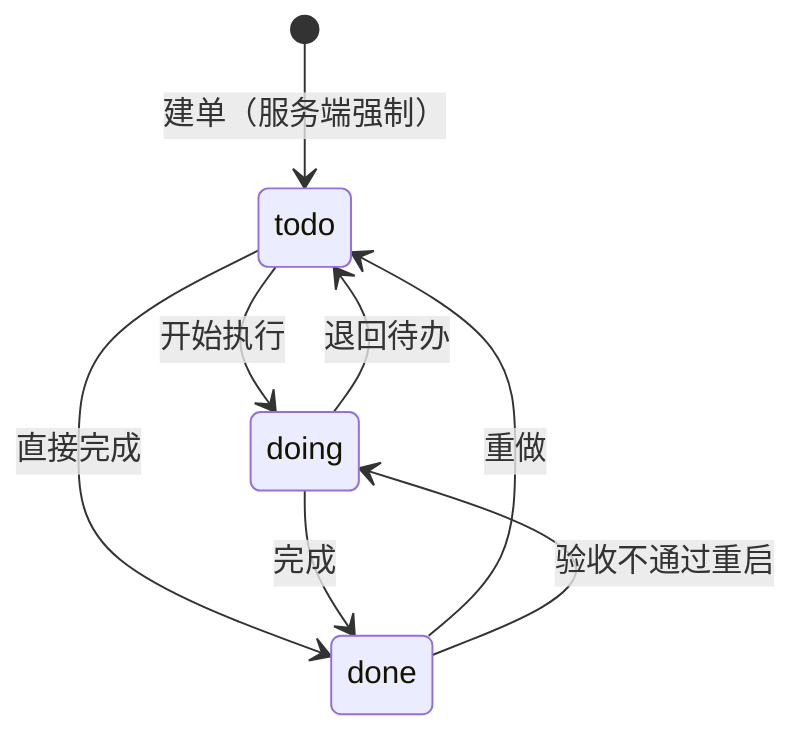
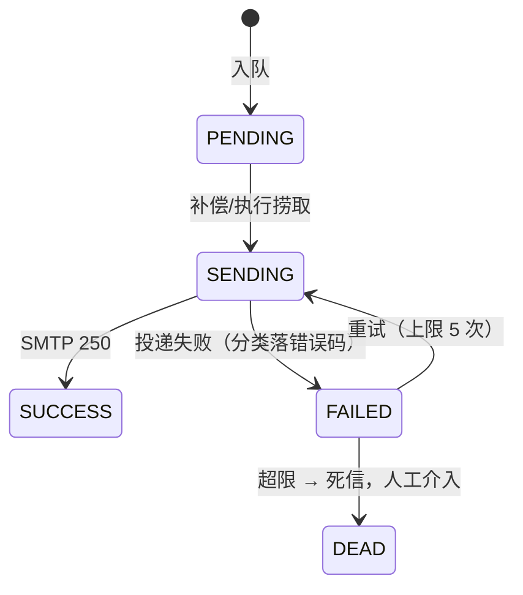

# 答辩备战笔记：module-team 与 module-mail 业务编排

> 整理：2026-11-19 · 睡前速览版
> 事实来源：`jeecg-module-team/docs/business-flow.md`、`jeecg-module-mail/docs/*wrapup*/*REPORT*`、两边枚举与控制器代码
> 用法：先背 §1 一句话定位和 §5 数字，再扫 §4 问答；卡壳就回来看 §2/§3 的图。

---

## 1. 一句话定位（开场必背）

| 模块 | 一句话 | 核心业务对象 |
|---|---|---|
| **jeecg-module-team** | 团队协作单据域：任务全生命周期 + 二级审批链，用一张审计表驱动产品时间线 | TeamTask / TeamApproval（+ Bug、AuditLog） |
| **jeecg-module-mail** | 邮件域：系统发信（模板/批量/幂等/重试）+ 员工邮箱绑定、IMAP 增量同步、读写删 | SystemMail*（系统侧）/ OaMail*（员工侧） |

两个模块通过 `oa_mail_biz_link`（业务关联表，封存线）预留集成点：邮件可挂任务/审批单据。

---

## 2. module-team 业务编排

### 2.1 任务状态机（六条流转全合法）



三个要点：
- **done 不是终态**——看板语义下允许重做/重启；同状态自流转非法。
- 流转只能走 `PUT /team/task/status` 一个口子；`/edit` 服务端强制回填库中状态，堵死"编辑顺带改状态"的旁路。
- 状态码唯一口径源：`TeamTaskStatus` 枚举 ↔ 库 `status` 列 ↔ 前端 `constants/task.ts`，三处不许散装字符串。

### 2.2 权限：两道闸门

```
请求 → ① Shiro 按钮权限（team:task:*，越权 403）
      → ② service 层归属校验（TeamOwnershipGuard，越权抛业务错误）
```
编辑/删除限创建人或管理员；流转限指派人/创建人/管理员；admin 全放行。

### 2.3 审批链（二级流程，试点硬编码）

```
提交 → 生成单号 OA-YYYYMMDD-NNN，主表 pending + 落步骤链
     → step1（部门主管）approve → 主表仍 pending，current_step=2
     → step2（副总）approve → 主表 approved
     → 任一步 reject → 该步骤 rejected + 主表 rejected，链终止
```
步骤校验口径：`approverName == 本人 且 状态 wait`。演进方向：模板体系（TeamApprovalTemplate）下发审批链，替换硬编码。

### 2.4 事件流设计（最大亮点，必考）

**不建独立事件表，复用 `team_audit_log` 做时间线数据源。**

| 产品事件 | audit action | from → to |
|---|---|---|
| 建单 | create | null → todo |
| 状态流转 | change_status | 旧状态 → 新状态 |
| 评论 | comment | null → 评论 id |
| 提交/通过/拒绝审批 | submit / approve / reject | 步骤快照 |

纪律：审计行**只增不改不删**，同事务写入（业务回滚则审计一起回滚）。已知取舍：audit（合规视角）与 timeline（产品视角）共用一表，字段语义以 audit 为准。

---

## 3. module-mail 业务编排

### 3.1 系统发信状态机（含重试与死信）



- **幂等**：`to_hash` 列 + 索引，同收件人同批次重复提交去重；traceId 进 MDC 全链路可查。
- **批量**：batch ≤ 500，逐条 outcome 不回滚整批。
- **错误分类器**（SmtpErrorClassifier）：连接特征优先于超时（JavaMail 失败文案自带 `; timeout NNNN` 的坑），错误码前缀化。

### 3.2 员工邮箱：绑定 → 增量同步 → 读写删

```
绑定：IMAP+SMTP 真实双握手测连 → AES 加密存密码（MailPasswordCodec 可插拔）
同步：MailSyncEngine 按 last_uid 游标拉增量 → 信封索引幂等 upsert → 游标推进
      （未识别文件夹不静默跳过，等用户做 canonical 映射）
读取：列表走本地索引；正文实时 IMAP FETCH 不落库（最小驻留）
      → 打开详情即已读（Outlook 口径，IMAP \Seen 置位 + 索引双写）
删除：Trash 映射优先（软删=迁移）；无映射走永久删除
写信：SMTP 发送 → best-effort 归档 Sent（IMAP append，失败仅告警不影响发送结果）
```

### 3.3 文件夹语义：canonical 归一

不同邮箱服务商文件夹名各异（Inbox/Sent/"已发送"/"Deleted Messages"…），模块用 `MailCanonicalFolder` 枚举做**别名映射归一**，业务代码只认 canonical 概念；未识别文件夹显式提示用户映射，而不是静默丢邮件。

---

## 4. 答辩预设问答

**Q1：任务 done 了为什么还能改？**
看板语义。真实协作里"验收不通过"要退回，所以 done 允许 → todo（重做）/ → doing（重启）。状态机六条流转全部显式定义，比"done 终态"更贴近业务，但每个转移都在服务端枚举里白名单校验。

**Q2：为什么不建独立的 task_event 表？**
GitHub 的 events 表与 audit_log 完全同构（实体+动作+前后值+操作人+时间）。另建表意味着每次操作双写，带来漂移风险；audit_log"只追加"的纪律天然满足事件流语义。代价是合规视角与产品视角耦合，已在文档中声明取舍。

**Q3：怎么防越权？**
两道闸门：接口层 Shiro 按钮权限（403）；service 层 TeamOwnershipGuard 按单据归属校验（编辑/删除限创建人，流转限指派人/创建人/管理员）。前端隐藏按钮不算安全，服务端才是闸门。

**Q4：邮件重复发送怎么办？**
发送表有 `to_hash`（收件人归一哈希）+ 唯一索引，同批次重复提交被幂等拒绝；日志全程带 traceId，可回放定位。

**Q5：邮箱密码怎么存？**
AES 对称加密入库，编解码抽象成 `MailPasswordCodec` 接口（`@ConditionalOnMissingBean` 可插拔，可替换 KMS/国密实现）。密钥走环境变量 `MAIL_CRYPTO_KEY`，不进 yml 不入库。

**Q6：IMAP 同步会不会很慢/漏信？**
增量同步：本地记每个文件夹 `last_uid` 游标，只拉 UID 大于游标的信封，幂等 upsert 后推进游标；重启不重来。已知 N+1 性能风险留二期批量 upsert。正确性有 GreenMail 进程内集成测试背书（真实 SMTP 投递 → IMAP 增量 → 游标推进，0.29s）。

**Q7：邮件正文怎么不存数据库？**
最小驻留原则：邮件正文体积大、有合规风险，只落信封索引（主题/发件人/时间/未读/附件标记）；打开详情时实时 FETCH，顺便置已读。256K 截断防异常大邮件。

**Q8：HTML 邮件怎么防 XSS？**
不引入 v-html 富文本渲染（邮件是 XSS 重灾区）。text/plain 优先，html-only 邮件本地剥标签转纯文本展示，格式损失可接受；要上也必须先做消毒，本期明确不做。

**Q9：发送失败了会怎样？**
状态机驱动：FAILED 进补偿任务重试（上限 5 次，无指数退避是已知项），超限转 DEAD 死信人工处理。SMTP 错误先经分类器转成结构化错误码（连接/认证/超时/地址），不是裸异常上抛。

**Q10：删除邮件是软删吗？**
看文件夹映射：目标邮箱有 Trash 映射就走迁移（等于软删，可找回）；无映射（如 QQ 的"Deleted Messages"未识别）按协议走永久删除——这是 IMAP 标准语义，不是实现偷懒，且 UI 已提示。

**Q11：两个模块什么关系？**
mail 通过 `oa_mail_biz_link` 预留与 team 单据（任务/审批）的关联点，本期封存：先把邮件闭环做扎实，集成是二期线。

**Q12：为什么是 8081 不是 jeecg 默认 8080？**
团队约定：云上 8080 是正式口径，本机前后端联调让后端 `--server.port=8081`，前端 vite 代理 `/jeecg-boot → 8081`，互不干扰。

---

## 5. 背数字（增加可信度）

| 证据 | 数字 |
|---|---|
| mail 模块单测 | **106/106 绿**（含 GreenMail 真实协议集成测试） |
| team 模块验证 | 真实邮箱冒烟：Inbox 61 封分页 4 页、写信→收件+Sent 归档双出现、删除索引同步 |
| 权限点 | mail 25 条 `team:mail:*` 权限行入 sys_permission |
| 建表 | Flyway V3.9.6_8（7 张表）+ _9（权限），均 success |
| 启动缺陷修复 | D-1（`@ConditionalOnMissingBean` 误标组件类）、D-2（模块未注册仓库）等，全部有根因记录 |

## 6. 一句话收尾（答辩结束语用）

> "team 模块解决'单据怎么流转、谁有资格动'，mail 模块解决'消息怎么可靠送达、怎么和外部邮箱互通'；两个模块都遵循同一个原则——**状态机和权限收敛到服务端唯一口径，每一句'应该可以'都有测试和真实协议握手背书**。"

---

## 7. 权限划分与确权流程（答辩专项）

### 7.1 四层确权模型（背这张）

```
① 认证   X-Access-Token（Shiro + JWT，Redis 会话）——你是谁
② 授权   @RequiresPermissions 按钮权限（team:task:* / team:mail:* 共 70+ 条）
         + 角色勾选（admin 全放行 / 蓝鸥成员 47 条 team 权限）——你能做哪类操作
③ 确权   service 层归属校验（TeamOwnershipGuard / OaMailOwnershipGuard）
         任务：编辑/删除限创建人，流转限指派人/创建人/管理员
         邮箱：只有绑定人能读写自己的邮箱
         ——这一张具体单据你能不能动
④ 审计   team_audit_log 只增不改不删（谁/何时/对哪张单据/前后值）
         ——动了留痕，确权追溯的证据链闭环
```

一句话：**前端隐藏按钮不算安全，闸门全部收敛在服务端；功能权限（②）与数据确权（③）是两层独立校验**。

### 7.2 为什么这么设计（必背三点）

1. **两道闸门分层**：接口层 403 挡"没权限的角色"，service 层挡"有角色但这不是你的单据"。RBAC 管不到数据行级，必须补归属校验——GitHub 也是这个口径（repo 权限 ≠ issue 操作权）。
2. **多租户隔离**：蓝鸥租户 id=1002，平台租户拦截器兜底，新查询不绕过。
3. **审计即确权证据**：审批/流转的每次确权结果落审计表，只追加，人事合规与技术排障共用一张表（已声明取舍）。

### 7.3 后续 agent 权限划分（展望，答辩加分项）

核心论点：**agent 不是新权限体系，是新 principal 类型——四层模型一层不改，只加约束**。

| 层 | agent 接入方式 |
|---|---|
| 身份 | agent 注册为 sys_user 的特殊类型（独立角色 `team_agent`） |
| 授权（最小权限） | 只勾 `team:task:list/board/status/comment`；**不给 delete/edit，审批人必须是人类**（确权责任不可代理） |
| 确权 | 零改动——OwnershipGuard 已认定"指派人可流转"，agent 作为 assignee 上板即被现有闸门约束 |
| 审计 | 审计行 operator 记 agent id + 委托人 id，全程可追溯 |
| 高敏闸门 | 复用已预留的 `AGENT_CONFIRM_REQUIRED` 错误码：agent 起草 → 人类确认 → 执行（human-in-the-loop） |

一句话：**人类与智能体共用同一套权限/确权/审计，不为其开任何旁路——能约束 agent 的代码，同样约束人**。

---

## 8. 技术栈选型与理由（中期分享）

| 层 | 选型 | 为什么（话术） |
|---|---|---|
| 后端基座 | Java 17 + Spring Boot 4.1 + MyBatis-Plus（jeecg-boot） | 低代码平台自带 RBAC/多租户/代码生成/审批生态，团队精力全部投业务不投基建；单体一个 jar 一个库，试点期运维面最小 |
| 鉴权 | Shiro + JWT + Redis 会话 | 平台既有方案；**会话外置 Redis = 未来拆服务时无状态化已达标**（为微服务留的路） |
| 前端 | Vue 3 + TypeScript + Vite 8，组件自研 | 类型安全 + 秒级热更新；目标是 GitHub Issues 式交互，自研轻量组件比搬 Ant Design Vue 重型库更贴设计（也是窄窗口弹性布局能一次治好的原因） |
| 存储 | MySQL 8 + Flyway | 单据/审批链强一致需求；迁移脚本版本化，schema 演进可审计（checksum 教训已实证并回填） |
| 邮件协议 | JavaMail（IMAP/SMTP）+ GreenMail 集成测试 | **不 mock 协议层**：真实"SMTP 投递→IMAP 增量→游标推进"进 CI（0.29s），对第三方邮箱行为的信心来自握手而非桩 |
| 明确不用 | MQ / Seata / K8s / ELK | 试点量级：最终一致用重试表，日志 grep 够，编排不上容器——每一项"不上"都有负收益论证（见微服务规划 §5） |

中期金句："**每个选型都回答同一个问题——试点阶段什么能少维护；每个'不上'都写进了规划文档的'明确不做'清单**。"

---

## 9. 两件待决事的落地分析

### 9.1 最小权限原则 —— 是原则，现在就能定

- agent 角色权限矩阵现在就设计好（见 §7.3），哪怕 agent 功能还没做；
- 人类侧已在受益：47 条 team 权限 vs admin 全放行，已是最小权限实例。

### 9.2 智能体团队（dsh agent-team-profile）—— 四要素已有三件套

| profile 要素 | 你们的现成对应 |
|---|---|
| 成员列表 | sys_user + 角色（agent 注册为新成员类型） |
| 团队工具 | 会话工作台 `/` 命令面板（申请/审批/Bug/报表）已是工具面 |
| 共享任务看板 | TaskBoard 三列看板——agent 作为 assignee 直接上板 |
| 团队协作 | team 单据流（状态机+归属校验+审计）本身就是协作协议 |

**结论：不需要另起炉灶，缺的不是功能，是三件事**：
1. agent principal 类型（注册 + 独立凭证 + 短时效可吊销 token）；
2. `team_agent` 最小权限角色（§7.3 矩阵）；
3. 高敏操作的人工确认闸门（`AGENT_CONFIRM_REQUIRED` 已有错误码预留）。

分期建议：一期 **agent-as-assignee**（看板领任务、流转状态、评论——全走现有闸门，后端几乎零改动）；二期 agent 起草 + 人类确认（审批/发信）；三期才谈 agent 间协作（现阶段不建议碰，确权责任链会糊）。

### 9.3 答辩口径

> "权限体系设计时就把智能体当一类新成员考虑：四层确权模型一层不改，agent 走与人类完全相同的两道闸门和审计链，额外只加一把锁——高敏操作人工确认。所以启用 agent 团队不是权限改造，而是**注册一个被最小权限约束的成员**。"
