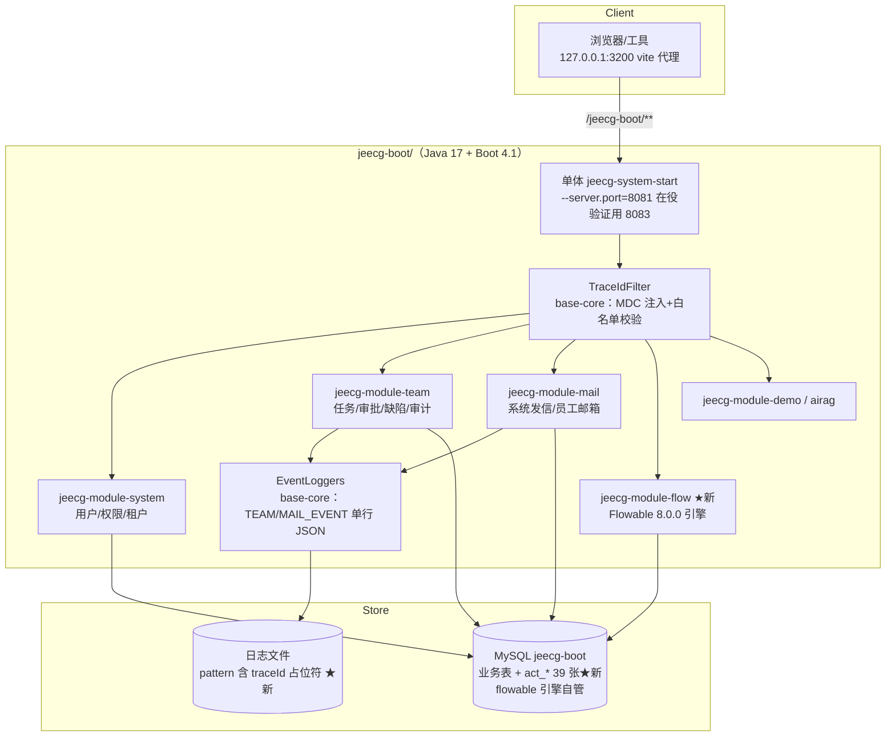
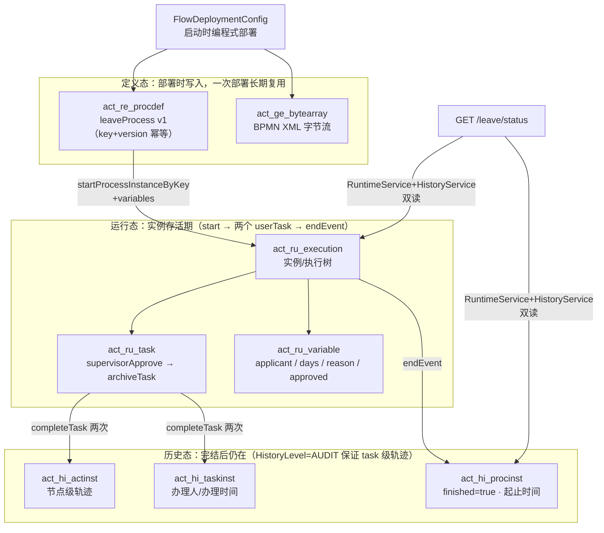
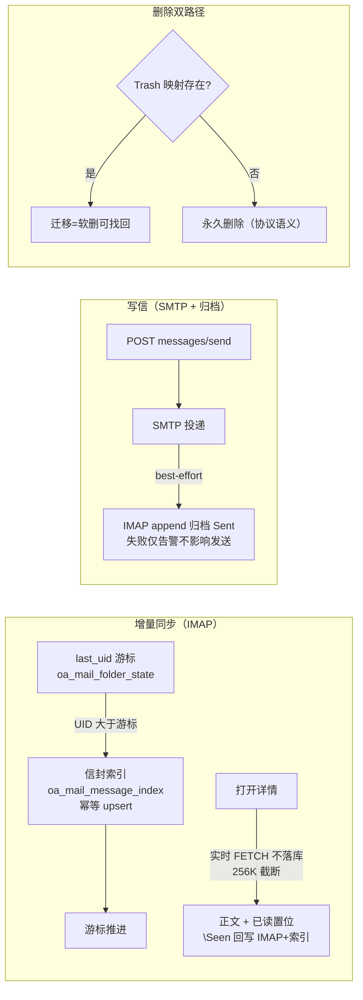
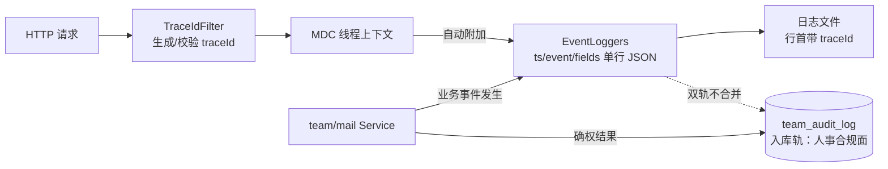
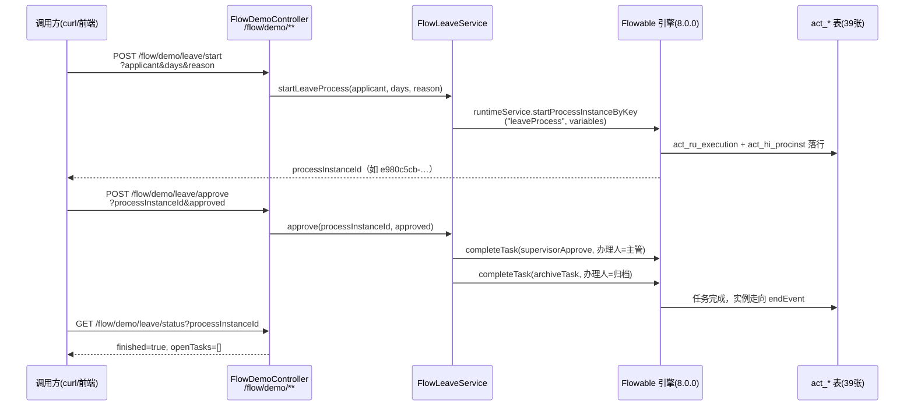
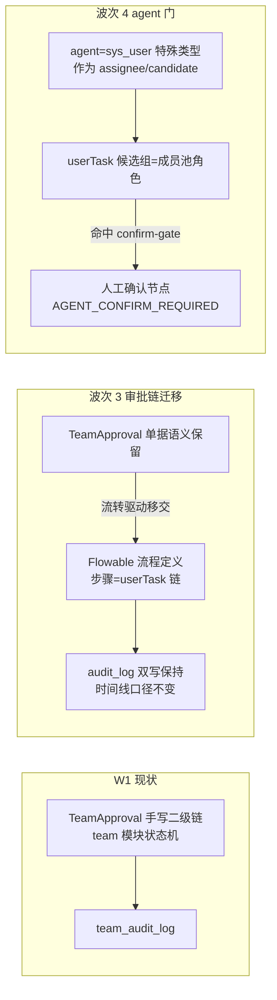
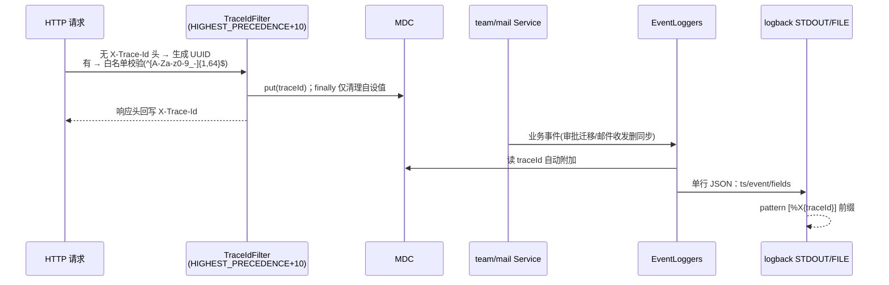
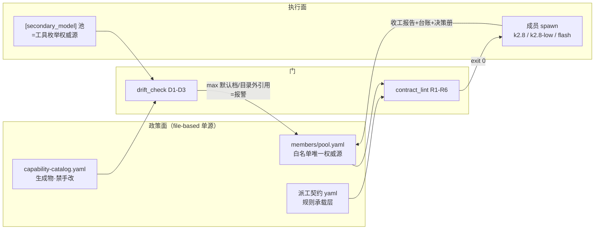

# 改动后流程图 —— 2026-11-19 晚（W1 + 观测性 + 治理基座落地后）

> 姊妹篇：本文与 `DEFENSE-业务编排与答辩-2026-11-19.md` 同体例（mermaid 图 + 要点 + 文件相对路径）。
> **路径基准：JeecgBoot 仓库根**（`C:\Users\22414\dev\JeecgBoot\`）；治理件在 `projects/agent-collab-pilot/` 下另标。
> 全部端点/ID 已与真实代码逐字核对（非凭记忆）。

---

## 1. 改动后单体全景

要点：
- **★新 = 今日改动**。flow 模块已注册进 system-start（下次启动引擎随单体起，39 表幂等自管）。
- 观测件（TraceIdFilter/EventLoggers）在 base-core，所有业务模块共享，不动在役逻辑。
- 文件：`jeecg-boot/jeecg-module-system/jeecg-system-start/pom.xml`（flow 接线行）、`jeecg-boot/jeecg-boot-base-core/src/main/java/org/jeecg/config/filter/TraceIdFilter.java`、`jeecg-boot/jeecg-boot-base-core/src/main/java/org/jeecg/common/log/EventLoggers.java`、`jeecg-boot/jeecg-module-system/jeecg-system-start/src/main/resources/logback-spring.xml`

## 2. 数据流转（新增：实例数据生命周期 + 邮件 + 观测三条流）

### 2.1 流程实例数据生命周期（W1 落地后的真实数据流）

要点：
- 部署幂等：同名 key 已存在则跳过（`FlowDeploymentConfig.java` 部署分支）；BPMN 文件进 git = 定义即代码，引擎表只存运行态。
- 变量 `approved` 随流程变量贯穿 supervisorApprove → archiveTask，是分支语义的唯一载体。
- 完结后运行表清空、历史表永驻——`status` 端点 finished 口径来自 `act_hi_procinst.END_TIME_`。
- 文件：`.../flow/config/FlowDeploymentConfig.java`、 `.../flow/service/FlowLeaveService.java:62`（变量装配）、`.../flow/config/FlowModuleConfig.java:34`（AUDIT）

### 2.2 邮件数据流（既有口径，锚点补全）

- 文件：`.../mail/sync/MailSyncEngine.java`（游标/upsert）、`.../mail/service/impl/OaMailServiceImpl.java`（详情已读/写信/删除调度）、`.../mail/service/impl/MailMessageOperator.java`（双路径）、表结构 `jeecg-boot/jeecg-module-system/jeecg-system-start/src/main/resources/flyway/sql/mysql/V3.9.6_8__oa_mail_init.sql`

### 2.3 观测数据流（今日落地）

- 审计双轨纪律：入库轨（合规/谁干了什么）与事件轨（技术/运营指标）字段语义互不污染。
- 异步线程（mail 发送/同步）的 traceId 透传：发送链路已有先例（`SystemMailServiceImpl` MDC put/remove）；同步链路待 tracker Redis 化后顺带携带（P1，已登记）。
- 文件：`jeecg-boot/jeecg-boot-base-core/src/main/java/org/jeecg/config/filter/TraceIdFilter.java`、`.../common/log/EventLoggers.java`、`jeecg-boot/jeecg-module-system/jeecg-system-start/src/main/resources/logback-spring.xml`

## 3. W1 请假流程：REST 端到端（已走通，实例可复验）

要点：
- 三个端点与代码逐字一致；BPMN id：`leaveProcess / supervisorApprove / archiveTask / startEvent / endEvent`。
- 流程定义**编程式部署**（嵌套 jar 下 starter 的 classpath* 扫描失效的实证绕法），启动时幂等（已部署则跳过并打 version 日志）。
- 冒烟口径：在役回归 `/team/task/board` 匿名 401（非 5xx）= 通过。
- 文件：`jeecg-boot/jeecg-boot-module/jeecg-module-flow/src/main/java/org/jeecg/modules/flow/controller/FlowDemoController.java`（`:26` @RequestMapping("/flow/demo")，`:34/44/53` 三端点）、`.../flow/service/FlowLeaveService.java`（`:62` startLeaveProcess，`:85` approve）、`.../flow/config/FlowDeploymentConfig.java`（`:23` 资源路径，部署幂等）、`.../flow/config/FlowModuleConfig.java`（`:34` HistoryLevel.AUDIT，`:35` 异步执行器开）、`.../flow/src/main/resources/processes/leave-process.bpmn20.xml`

## 4. W3/W4 演进位置（设计已定，未施工——虚线为未来）

要点：
- W3 并行期双写零差异再切流；W4 复用治理基座"身份底座唯一"原则（agent 不建独立身份栈）。
- 文件（届时动）：`jeecg-boot/jeecg-boot-module/jeecg-module-team/src/main/java/org/jeecg/modules/team/service/impl/TeamApprovalServiceImpl.java`（现状锚点，`:submit` 落单号与步骤链处）；设计：`projects/agent-collab-pilot/docs/27-flowable-bpm-project-charter.md` §三

## 5. 观测性：traceId 全链 + 业务事件（今日落地）

事件清单（触发点=真实代码位置）：
- `approval.submitted / transition / validation_failed`：`jeecg-boot/jeecg-boot-module/jeecg-module-team/src/main/java/org/jeecg/modules/team/service/impl/TeamApprovalServiceImpl.java`（transition 含 8 处并发冲突拒绝负路径，action 复用 `TeamAuditAction.getCode()`）
- `mail.bind/unbind/sent/deleted`：`jeecg-boot/jeecg-boot-module/jeecg-module-mail/src/main/java/org/jeecg/modules/mail/service/impl/OaMailServiceImpl.java`（additive 单行事件，业务逻辑零改）
- `mail.sync`：`.../mail/sync/MailSyncEngine.java`（每轮同步结束；异步线程 traceId 串链待 tracker Redis 化后透传——P1 跟进）
- mail 发送异步 MDC 透传先例：`.../mail/service/impl/SystemMailServiceImpl.java`
- 审计双轨：`TeamAuditLogger` 入库轨一行未动，事件日志是技术/运营面。

## 6. 治理基座：派工闭环与漂移防线（今日 dogfooding 实证）

今日三案例（防线回写实录）：
1. K2.8/K3：政策引用池外别名 → 池收敛为白名单两项，工具层物理强制；
2. 思考档 max：`default_effort=max` 烧 token → 目录增思考档键 + D3 规则（max 禁默认档，**含 config 被其他运行时回退的防线**）；
3. display_name 直引 → R2 回归测试永久钉住。
- 文件：`projects/agent-collab-pilot/governance/src/capability_catalog.py`、`.../src/contract_lint.py`（R6 池绑定 `:277`）、`.../src/drift_check.py`（D3 `:74`）、`.../members/pool.yaml`、`.../contracts/_template.yaml`

## 7. 未变业务流指针（图见 DEFENSE 笔记，此处只留代码锚点）

- 任务状态机（六流转）+ 两道闸门：`jeecg-boot/jeecg-boot-module/jeecg-module-team/src/main/java/org/jeecg/modules/team/service/impl/TeamTaskServiceImpl.java`（changeStatus 链式校验）/ `.../service/impl/TeamOwnershipGuard.java`
- 审批二级链：`.../team/service/impl/TeamApprovalServiceImpl.java` + `.../service/impl/ApprovalFormValidator.java`
- 邮件发送状态机（PENDING→SENDING→SUCCESS/FAILED→DEAD）：`.../jeecg-module-mail/src/main/java/org/jeecg/modules/mail/enums/MailSendStatus.java`；同步引擎游标：`.../mail/sync/MailSyncEngine.java`
- 图：`DEFENSE-业务编排与答辩-2026-11-19.md` §2/§3（mermaid 状态机与时序原图）
